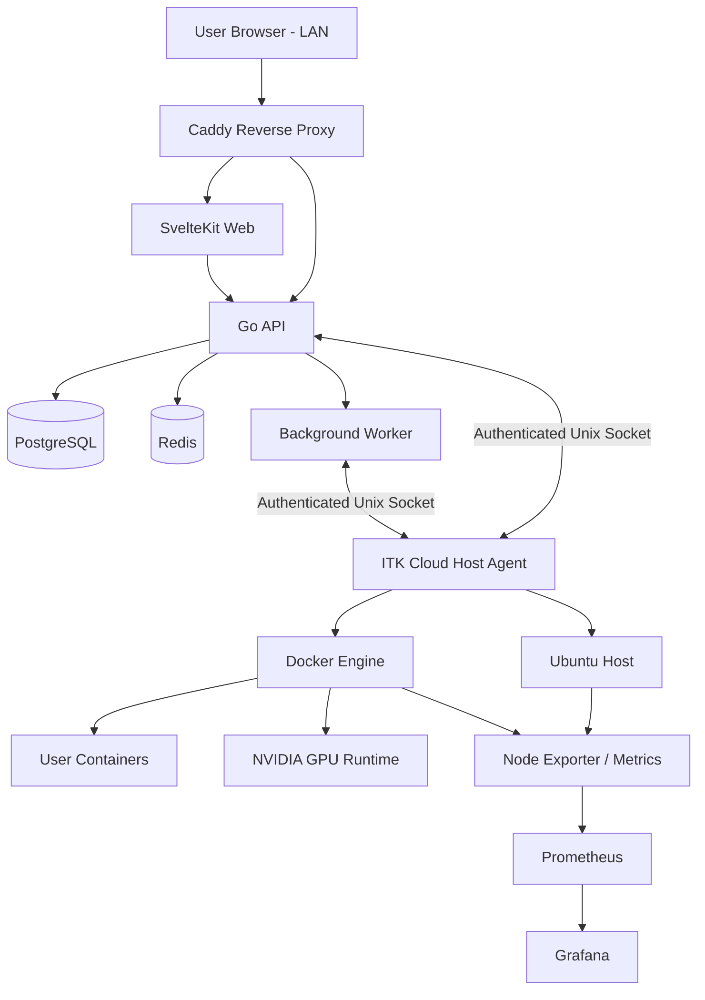
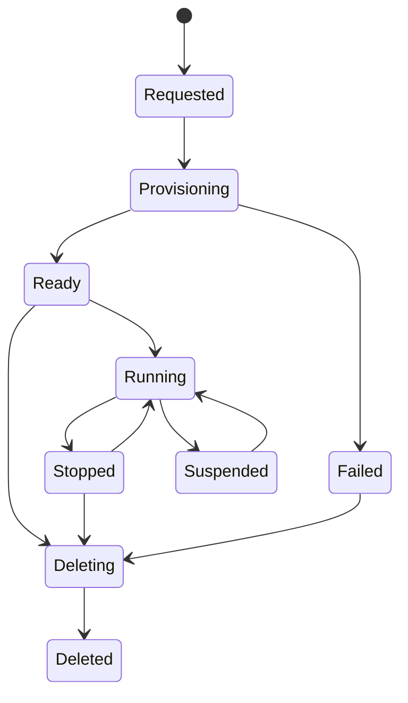

# ITK Cloud — Product & Technical Specification
## Blueprint Implementasi Menggunakan AI Coding Agent

**Nama produk:** ITK Cloud  
**Kepanjangan:** Informatika dan Teknik Komputer Cloud Platform  
**Jenis aplikasi:** Private cloud platform untuk laboratorium Informatika dan Teknik Komputer  
**Target server:** Ubuntu Server 24.04 LTS, satu server fisik, akses LAN saja, NVIDIA GPU tersedia  
**Tujuan dokumen:** Menjadi spesifikasi utama (*source of truth*) bagi AI coding agent untuk merancang, membangun, menguji, dan menyiapkan deployment aplikasi.

---

# 1. Instruksi Utama untuk AI Agent

Bertindaklah sebagai tim pengembang senior yang terdiri dari:
- Software Architect
- Senior Go Backend Engineer
- Senior SvelteKit Frontend Engineer
- DevOps / Linux Engineer
- Database Engineer
- Application Security Engineer
- QA / Test Engineer

Bangun aplikasi **ITK Cloud** berdasarkan dokumen ini. Aplikasi harus benar-benar dapat dijalankan, bukan sekadar mockup atau kumpulan halaman statis.

## Aturan kerja AI Agent

1. Baca seluruh dokumen sebelum membuat perubahan.
2. Buat `docs/implementation-plan.md` yang memecah pekerjaan menjadi fase, task, dependensi, dan kriteria selesai.
3. Periksa versi stabil terbaru dari Go, Node.js, SvelteKit, Svelte, PostgreSQL, Redis, Docker, dan library yang dipilih melalui dokumentasi resmi sebelum menetapkan versi. Jangan mengarang nomor versi.
4. Gunakan versi stabil dan saling kompatibel. Kunci versi dependency dalam lockfile.
5. Gunakan monorepo. Pisahkan frontend, backend API, host agent, CLI, shared contracts, deployment, dan dokumentasi.
6. Terapkan modular monolith untuk backend utama. Jangan memecah menjadi microservices tanpa kebutuhan nyata.
7. Implementasikan fitur secara vertikal: database → API → UI → test. Jangan membuat semua UI lebih dahulu dengan data palsu.
8. Jangan meninggalkan tombol, menu, form, atau endpoint yang hanya berupa placeholder. Jika fitur belum tersedia, tampilkan status yang jelas dan jangan mengklaim fitur sudah berjalan.
9. Setiap fitur harus memiliki validasi input, otorisasi, audit log yang sesuai, error handling, dan automated test.
10. Jangan pernah mengekspos Docker socket, host root shell, credential, atau arbitrary command execution kepada browser maupun pengguna biasa.
11. Jangan menjalankan command destruktif pada host tanpa konfirmasi eksplisit administrator.
12. Setelah setiap fase, jalankan formatter, linter, unit test, integration test yang relevan, dan build.
13. Perbarui dokumentasi dan checklist implementasi setelah setiap fase.
14. Jika terdapat keputusan yang belum ditentukan, pilih opsi yang paling aman dan sederhana, dokumentasikan asumsi, dan jangan menghentikan pekerjaan untuk pertanyaan yang tidak kritis.
15. Jangan menghapus atau menimpa data pengguna saat upgrade. Sediakan backup, migrasi, dan prosedur rollback.

## Definition of Done

Sebuah fitur dianggap selesai jika:
- Berfungsi end-to-end pada lingkungan lokal/development.
- Memiliki migration atau perubahan schema bila diperlukan.
- Memiliki API contract dan validasi.
- Memiliki authorization dan ownership check.
- Memiliki automated test untuk alur utama dan kasus gagal.
- Memiliki loading, empty, success, dan error state pada UI.
- Memiliki audit log untuk aksi administratif atau sensitif.
- Didokumentasikan.
- Tidak memiliki secret atau credential hardcoded.

---

# 2. Ringkasan Produk

ITK Cloud adalah platform private cloud berbasis web untuk mengelola sumber daya komputasi laboratorium. Dosen, mahasiswa, asisten, peneliti, dan administrator dapat menggunakan satu portal untuk mengakses workspace, terminal, file, container, database, GPU, serta memantau penggunaan resource.

Platform berjalan pada satu server Ubuntu di jaringan lokal kampus/laboratorium. Sistem menyediakan dua jenis workspace:

1. **Linux-native workspace** — lingkungan kerja menggunakan akun Linux dan direktori pengguna di host. Penggunaan fitur ini harus dibatasi dan diawasi karena proses berjalan pada host.
2. **Container workspace** — lingkungan kerja terisolasi menggunakan container. Ini menjadi pilihan default untuk mayoritas pengguna dan workload.

Aplikasi menyediakan kontrol terpusat untuk identitas pengguna, akses, kuota, workspace, container, GPU, monitoring, dan administrasi server.

## Sasaran utama

- Memudahkan pengguna laboratorium memperoleh lingkungan komputasi.
- Mengurangi pekerjaan manual administrator dalam membuat akun dan workspace.
- Menyediakan akses terminal dan file melalui browser.
- Mendukung pengembangan aplikasi, pemrograman, data science, machine learning, dan riset.
- Mengelola penggunaan CPU, RAM, storage, dan GPU secara terukur.
- Menyediakan monitoring dan audit aktivitas administratif.
- Menjaga server tetap aman dan stabil meskipun digunakan banyak pengguna.

## Bukan tujuan versi awal

- Multi-server cluster atau Kubernetes.
- Public cloud yang dapat diakses langsung dari internet.
- Virtualisasi penuh seperti VMware/Proxmox.
- Billing/payment gateway.
- Arbitrary root access untuk pengguna.
- High availability multi-node.
- Menjalankan workload tidak tepercaya tanpa isolasi yang memadai.

---

# 3. Pengguna dan Role

Implementasikan RBAC (Role-Based Access Control) dan pemeriksaan kepemilikan resource.

## Role bawaan

### 3.1 Super Administrator
- Mengelola seluruh konfigurasi platform.
- Mengelola administrator dan seluruh pengguna.
- Melihat semua workspace dan resource.
- Mengelola host agent, container runtime, GPU, kuota, backup, dan audit log.
- Menghentikan workload jika terjadi kondisi darurat.
- Menjalankan operasi host yang diizinkan melalui agent.

### 3.2 Administrator
- Mengelola pengguna sesuai permission yang diberikan.
- Membuat dan mengelola workspace.
- Mengelola template workspace dan kuota.
- Memantau penggunaan resource.
- Mengelola container dan database yang berada dalam cakupan kewenangannya.
- Tidak otomatis memperoleh akses root host.

### 3.3 Dosen / Researcher
- Membuat project dan workspace.
- Mengundang atau menambahkan anggota project jika diizinkan.
- Mengelola file, terminal, container, dan database project.
- Mengajukan penggunaan GPU.
- Melihat penggunaan resource milik sendiri dan project.

### 3.4 Asisten Laboratorium
- Membantu pengelolaan workspace sesuai scope.
- Memantau status workload.
- Membantu pengguna.
- Tidak boleh mengakses data privat pengguna tanpa permission khusus.

### 3.5 Mahasiswa / Student
- Menggunakan workspace yang diberikan.
- Mengelola file dan project sendiri.
- Menjalankan terminal dalam workspace.
- Membuat container dari template yang diizinkan.
- Mengajukan alokasi GPU sesuai kebijakan.
- Melihat kuota dan penggunaan sendiri.

## Permission

Gunakan permission granular, bukan hanya pemeriksaan nama role. Contoh:
- `users.view`, `users.create`, `users.update`, `users.suspend`
- `workspaces.view_own`, `workspaces.view_all`, `workspaces.create`, `workspaces.delete`
- `containers.create`, `containers.stop`, `containers.manage_all`
- `gpu.request`, `gpu.approve`, `gpu.manage`
- `host.operations.view`, `host.operations.execute`
- `audit.view`, `backup.manage`, `settings.manage`

Semua endpoint harus memeriksa permission dan ownership di sisi backend. Menyembunyikan tombol di frontend bukan mekanisme keamanan.

---

# 4. Arsitektur Sistem

## 4.1 Prinsip arsitektur

- Single-server deployment untuk tahap awal.
- LAN-only; tidak ada endpoint administrasi yang dipublikasikan ke internet.
- Backend utama menggunakan Go modular monolith.
- Host agent berjalan sebagai service terpisah dengan privilege minimum.
- Frontend menggunakan SvelteKit.
- PostgreSQL sebagai database utama.
- Redis untuk cache, queue, session coordination, dan pub/sub bila diperlukan.
- Docker Engine untuk container workspace.
- NVIDIA Container Toolkit untuk akses GPU dalam container.
- Caddy sebagai reverse proxy dan internal HTTPS.
- systemd untuk mengelola service.
- Prometheus dan Grafana untuk monitoring infrastruktur.

## 4.2 Diagram konseptual



## 4.3 Batas kepercayaan

- Browser tidak pernah berkomunikasi langsung dengan Docker Engine.
- Backend tidak menerima arbitrary shell command dari pengguna.
- Host agent hanya menerima operasi terstruktur yang diizinkan.
- Container user dianggap sebagai workload tidak tepercaya.
- Data pengguna tidak boleh dapat dibaca oleh pengguna lain.
- API dan agent harus saling mengautentikasi.
- Operasi berisiko tinggi membutuhkan permission khusus dan audit log.

---

# 5. Teknologi

Gunakan teknologi berikut, dengan versi stabil terbaru yang kompatibel saat implementasi dimulai.

| Komponen | Teknologi |
|---|---|
| Host OS | Ubuntu Server 24.04 LTS |
| Backend | Go |
| Frontend | SvelteKit + Svelte 5 + TypeScript |
| Styling | Tailwind CSS v4 |
| UI components | shadcn-svelte atau komponen Svelte yang terawat |
| Database | PostgreSQL |
| Cache / Queue | Redis |
| Container | Docker Engine |
| GPU Container | NVIDIA Driver + NVIDIA Container Toolkit |
| Reverse Proxy | Caddy |
| Terminal | xterm.js |
| Realtime | WebSocket |
| Metrics | Prometheus + Grafana |
| Host service | systemd |
| Logging | Structured JSON logging |
| API documentation | OpenAPI |
| Testing | Go test, frontend unit tests, browser E2E tests |

AI Agent harus memverifikasi dokumentasi resmi sebelum memilih library tambahan. Hindari dependency yang tidak aktif dipelihara.

---

# 6. Monorepo dan Struktur Folder

Gunakan satu repository dengan struktur awal:

```text
itk-cloud/
├── apps/
│   ├── api/                    # Go HTTP API
│   ├── worker/                 # Background jobs
│   ├── agent/                  # Privileged host agent
│   ├── web/                    # SvelteKit application
│   └── cli/                    # Optional admin CLI
├── packages/
│   ├── api-contracts/          # OpenAPI and shared schemas
│   ├── ui/                     # Shared UI components
│   └── config/                 # Shared lint/build configuration
├── deployments/
│   ├── systemd/
│   ├── caddy/
│   ├── docker/
│   └── monitoring/
├── installer/
│   ├── install.sh
│   ├── upgrade.sh
│   ├── backup.sh
│   └── uninstall.sh
├── docs/
│   ├── architecture.md
│   ├── security.md
│   ├── api.md
│   ├── installation.md
│   ├── operations.md
│   ├── backup-restore.md
│   ├── implementation-plan.md
│   └── adr/
├── tests/
│   ├── integration/
│   ├── e2e/
│   └── security/
├── Makefile
├── .env.example
├── .gitignore
└── README.md
```

Sesuaikan struktur bila tooling Go atau SvelteKit membutuhkan konfigurasi tambahan. Jangan mencampur kode host agent dengan API utama.

---

# 7. Modul Backend

Gunakan pendekatan modular monolith. Setiap modul memiliki domain model, service/use-case, repository interface, transport handler, dan test.

Modul minimum:

1. `auth` — login, logout, session, password reset, MFA.
2. `users` — profil, status, role, quota assignment.
3. `rbac` — role, permission, policy.
4. `projects` — project, anggota, kepemilikan.
5. `workspaces` — provisioning, lifecycle, template.
6. `terminals` — terminal session dan WebSocket relay.
7. `files` — file listing, upload, download, operasi file terbatas.
8. `containers` — create, start, stop, restart, inspect, logs.
9. `images` — image catalog dan allowlist image.
10. `databases` — provisioning database dan credential management.
11. `gpu` — inventory, request, approval, allocation, release.
12. `resources` — CPU, RAM, storage, quota, usage.
13. `monitoring` — host dan workload metrics.
14. `notifications` — notifikasi aplikasi.
15. `audit` — aktivitas dan operasi sensitif.
16. `backups` — backup, restore, retention.
17. `settings` — konfigurasi platform.
18. `agent` — komunikasi dan status host agent.

## Standar implementasi backend

- REST API dengan prefix `/api/v1`.
- JSON request/response yang konsisten.
- Validasi input di server.
- Pagination, sorting, dan filtering untuk daftar data.
- Timeout dan cancellation untuk operasi.
- Context propagation pada semua operasi I/O.
- Structured logging dengan request ID.
- Error response tidak membocorkan stack trace atau secret.
- Database transaction untuk operasi multi-tabel.
- Idempotency untuk operasi provisioning yang dapat diulang.
- Background job untuk proses lama.
- OpenAPI sebagai kontrak API.
- Health endpoints: `/health/live` dan `/health/ready`.

---

# 8. Host Agent

`itk-cloud-agent` adalah service Go terpisah yang berjalan di Ubuntu dan bertugas melakukan operasi host yang diperlukan platform.

## Tanggung jawab

- Mengambil informasi CPU, RAM, disk, OS, kernel, dan GPU.
- Memeriksa status Docker dan NVIDIA runtime.
- Membuat dan mengelola workspace directory.
- Mengelola container melalui Docker API.
- Menerapkan CPU, memory, PID, dan storage limits.
- Mengelola terminal PTY dalam workspace yang telah diotorisasi.
- Mengambil metrics workload.
- Menjalankan operasi administratif yang telah di-allowlist.

## Keamanan agent

- Berjalan sebagai user service khusus jika memungkinkan.
- Gunakan Unix domain socket dengan permission filesystem ketat.
- Jika operasi tertentu memerlukan privilege, gunakan helper kecil dengan daftar operasi eksplisit.
- Jangan menyediakan endpoint `exec(command: string)` generik.
- Jangan menerima path arbitrer tanpa validasi.
- Validasi canonical path dan pastikan tetap berada dalam root workspace.
- Batasi ukuran request, timeout, dan jumlah proses.
- Setiap operasi membawa actor ID, resource ID, correlation ID, dan alasan.
- Agent mencatat operasi sensitif ke log.
- Backend dan agent harus menggunakan protokol request/response berversi.
- Sediakan health check dan agent version check.

## Contoh operasi terstruktur

```json
{
  "operation": "workspace.create",
  "request_id": "uuid",
  "actor_id": "user-id",
  "workspace_id": "workspace-id",
  "payload": {
    "owner_id": "user-id",
    "template_id": "python-data-science",
    "storage_limit_bytes": 10737418240
  }
}
```

Contoh tersebut adalah ilustrasi kontrak, bukan izin untuk menerima operasi bebas. Implementasikan schema validation dan allowlist operasi di agent.

---

# 9. Modul Frontend dan UX

Frontend harus modern, responsif, profesional, dan nyaman digunakan pada desktop maupun tablet. Prioritaskan desktop untuk terminal dan pengelolaan resource.

## 9.1 Layout utama

- Sidebar navigasi yang dapat diciutkan.
- Topbar dengan pencarian, notifikasi, status server, dan profil.
- Breadcrumb.
- Konten utama.
- Tema light dan dark.
- Responsive layout.
- Toast notification.
- Dialog konfirmasi untuk aksi destruktif.
- Skeleton/loading state.
- Empty state yang memberi arahan.
- Error state dengan pesan yang aman dan dapat ditindaklanjuti.

## 9.2 Halaman

### Public / Authentication
- Login
- Forgot password
- Reset password
- MFA challenge
- Session expired

### Dashboard
- Welcome panel
- Ringkasan workspace aktif
- CPU, RAM, storage, dan GPU usage
- Container yang berjalan
- Aktivitas terbaru
- Pengumuman administrator
- Quick actions

### Workspace
- Daftar workspace
- Detail workspace
- Create workspace wizard
- Workspace template catalog
- Start / stop / restart
- Resource usage
- Workspace settings
- Workspace members

### Terminal
- Terminal berbasis xterm.js
- WebSocket connection
- Reconnect handling
- Resize terminal
- Copy/paste
- Session status
- Pemilihan workspace
- Indikator koneksi
- Terminal hanya terhubung ke workspace yang diizinkan

### File Manager
- Folder tree
- Breadcrumb
- File list
- Upload / download
- Create folder
- Rename
- Delete dengan konfirmasi
- Text editor untuk file teks
- Ukuran file dan batas upload
- Proteksi path traversal

### Projects
- Daftar project
- Project detail
- Project members
- Workspace terkait
- File dan resource terkait
- Activity log project

### Containers
- Container list
- Container detail
- Status dan uptime
- Image
- CPU / RAM usage
- Logs
- Start / stop / restart
- Create container dari template
- Resource limits
- Terminal attach sesuai permission

### GPU Center
- GPU inventory
- Model GPU
- VRAM total dan terpakai
- GPU utilization
- Proses/container pengguna
- Request GPU
- Approval queue
- Allocation status
- Jadwal penggunaan bila scheduling diaktifkan

### Database
- Database instances
- Create database
- Connection information
- Credential reset
- Usage
- Backup status
- Hapus database dengan konfirmasi

### Monitoring
- Host metrics
- CPU history
- Memory history
- Disk usage
- Network throughput
- GPU metrics
- Container metrics
- Alert history

### Notifications
- System notification
- Workspace notification
- GPU request status
- Quota warning
- Maintenance announcement

### Administration
- User management
- Role and permission management
- Project management
- Workspace management
- Template management
- Resource quota
- GPU allocation policy
- Container image allowlist
- Host status
- Agent status
- Audit logs
- Backup management
- Platform settings

---

# 10. Workspace Architecture

Setiap pengguna dapat memiliki satu atau lebih workspace. Workspace harus mempunyai owner, status, template, resource limit, storage quota, dan audit trail.

## 10.1 Tipe workspace

### Linux-native workspace
- Menggunakan akun Linux khusus atau mekanisme isolasi yang dirancang dengan aman.
- Setiap pengguna memiliki home directory terpisah.
- Tidak memberikan sudo secara default.
- Terapkan filesystem permission, cgroups, process limits, dan batas storage.
- Host shell hanya tersedia untuk role dan kebutuhan yang telah disetujui.
- Jangan menjadikan Linux-native workspace sebagai default untuk mahasiswa.

### Container workspace
- Default untuk mayoritas pengguna.
- Satu atau lebih container sesuai kebijakan.
- Setiap container memiliki CPU, memory, PID, dan storage limit.
- Gunakan non-root user di dalam container.
- Terapkan seccomp dan AppArmor.
- Hindari privileged container.
- Jangan mount Docker socket.
- Batasi Linux capabilities.
- Terapkan network policy dan pembatasan port.
- Image berasal dari katalog yang diizinkan.
- Container dapat dihentikan otomatis berdasarkan idle policy jika diaktifkan.

**Catatan isolasi:** Container berbagi kernel host. Container bukan pengganti VM untuk workload yang sangat berisiko. Jika pengguna menjalankan kode yang benar-benar tidak tepercaya atau membutuhkan isolasi kuat, evaluasi microVM atau VM terpisah sebelum membuka akses tersebut.

## 10.2 Workspace lifecycle



Setiap transisi harus divalidasi oleh backend dan dicatat. Provisioning dan deletion dijalankan sebagai background job yang idempotent.

## 10.3 Template awal

- Ubuntu Development
- Go Development
- PHP / Laravel Development
- Node.js Development
- Python Development
- Python Data Science
- JupyterLab
- Machine Learning CUDA
- C / C++ Development
- Java Development
- Web Development

Template harus memiliki metadata image, versi runtime, resource minimum/rekomendasi, port yang dibutuhkan, kebutuhan GPU, dan kebijakan keamanan.

---

# 11. GPU Management

GPU harus dikelola melalui satu modul khusus.

## Fitur

- Deteksi GPU melalui host agent.
- Tampilkan nama GPU, driver, total VRAM, free VRAM, utilization, dan temperature jika tersedia.
- Catat GPU inventory secara periodik.
- Pengguna dapat mengajukan akses GPU.
- Administrator dapat menyetujui atau menolak permintaan.
- Allocation memiliki owner, workspace/container, waktu mulai, batas waktu, dan status.
- Mendukung kebijakan eksklusif atau shared sesuai kemampuan perangkat dan workload.
- Sediakan mekanisme release allocation.
- Deteksi allocation yang tertinggal setelah container berhenti.
- Catat riwayat penggunaan GPU.

## Kebijakan

- Jangan mengasumsikan GPU mendukung MIG. Periksa model dan dukungan aktual.
- Jangan menjanjikan pembagian VRAM yang tidak benar-benar didukung hardware/runtime.
- Untuk tahap awal, gunakan allocation eksklusif atau kuota/persetujuan yang konservatif.
- GPU allocation harus terikat pada container/workspace tertentu.
- Batasi akses device GPU pada container yang disetujui.
- Jika GPU tidak tersedia, workspace non-GPU tetap dapat berjalan.

---

# 12. Resource Quota dan Scheduler

Setiap user, project, dan workspace dapat memiliki batas resource.

## Resource yang dikelola

- CPU limit
- Memory limit
- Storage quota
- Jumlah workspace
- Jumlah container
- Jumlah database
- GPU access
- Durasi maksimum workspace
- Idle timeout
- Jumlah terminal session

## Contoh paket quota

Nilai berikut hanya contoh awal dan harus dapat diubah administrator berdasarkan kapasitas server.

| Paket | CPU | RAM | Storage |
|---|---:|---:|---:|
| Basic | 1 core | 1 GB | 5 GB |
| Standard | 2 core | 4 GB | 20 GB |
| Research | 4 core | 8 GB | 50 GB |

Scheduler harus memeriksa kapasitas host dan quota sebelum provisioning. Jangan hanya mengandalkan angka quota di database; enforce limit di OS/container runtime menggunakan cgroups dan mekanisme storage yang sesuai.

---

# 13. Terminal dan Realtime

- Gunakan xterm.js pada frontend.
- Backend mengelola autentikasi, otorisasi, dan relay WebSocket.
- Host agent membuat PTY hanya setelah backend memverifikasi user dan workspace.
- Setiap terminal session terikat ke user, workspace, dan masa berlaku.
- Terapkan idle timeout dan batas jumlah session.
- Reconnect harus memvalidasi ulang session.
- Jangan mengirim secret melalui query string.
- Jangan menyimpan isi terminal secara default. Jika session recording dibutuhkan, jadikan fitur eksplisit dengan kebijakan privasi, pemberitahuan, dan retensi.
- Terminal tidak boleh menjadi jalan pintas untuk memperoleh host root.

---

# 14. File Manager

- Semua operasi file harus dibatasi pada root directory workspace.
- Normalisasi dan validasi path di backend/agent.
- Tolak path traversal, symlink escape, dan akses ke path sistem.
- Terapkan batas ukuran upload dan download.
- Gunakan streaming untuk file besar.
- Periksa permission setiap operasi.
- Audit operasi delete dan perubahan permission.
- Jangan mengirim path host absolut ke browser jika tidak diperlukan.
- File editor hanya untuk tipe file yang didukung dan ukuran yang wajar.

---

# 15. Database Management

Platform dapat menyediakan database untuk project pengguna.

## Tahap awal

- PostgreSQL sebagai database platform.
- Database project dapat dibuat sebagai database/schema terpisah sesuai model isolasi yang dipilih.
- Credential dibuat secara acak dan disimpan dengan aman.
- Password hanya ditampilkan saat dibuat atau di-reset.
- Hak akses database dibatasi per project.
- Backup database project harus terpisah dari backup database platform.
- Jangan memberikan akses superuser PostgreSQL kepada pengguna.

Pertimbangkan PostgreSQL role/database per project atau instance terisolasi jika kebutuhan keamanan dan resource menuntutnya. Dokumentasikan trade-off dan jangan mengklaim schema terpisah setara dengan isolasi instance penuh.

---

# 16. Database Schema Awal

Buat migration untuk entitas berikut. Tambahkan kolom audit dan timestamp yang sesuai.

- `users`
- `roles`
- `permissions`
- `role_permissions`
- `user_roles`
- `sessions`
- `mfa_methods`
- `projects`
- `project_members`
- `workspace_templates`
- `workspaces`
- `workspace_members`
- `containers`
- `container_images`
- `terminal_sessions`
- `gpu_devices`
- `gpu_requests`
- `gpu_allocations`
- `resource_quotas`
- `resource_usage_samples`
- `databases`
- `notifications`
- `audit_logs`
- `backup_jobs`
- `agent_nodes`
- `platform_settings`
- `background_jobs` atau tabel queue bila menggunakan queue database

## Ketentuan data

- Gunakan UUID atau ID yang konsisten.
- Tambahkan unique constraint dan foreign key.
- Tambahkan index untuk kolom pencarian dan relasi.
- Gunakan soft delete hanya jika lifecycle dan retensinya jelas.
- Simpan waktu dalam UTC; tampilkan waktu lokal di UI.
- Jangan menyimpan password plaintext.
- Enkripsi secret yang perlu dipulihkan menggunakan key yang dikelola di luar database.
- Hindari menyimpan token atau credential di log.
- Audit log harus append-only dari sisi aplikasi biasa.

---

# 17. API Contract Awal

Semua endpoint berada di `/api/v1`. Endpoint di bawah adalah rancangan awal; AI Agent harus menyempurnakan OpenAPI contract.

## Authentication
- `POST /auth/login`
- `POST /auth/logout`
- `GET /auth/me`
- `POST /auth/forgot-password`
- `POST /auth/reset-password`
- `POST /auth/mfa/verify`

## Users
- `GET /users`
- `POST /users`
- `GET /users/{id}`
- `PATCH /users/{id}`
- `POST /users/{id}/suspend`
- `POST /users/{id}/reset-password`

## Projects
- `GET /projects`
- `POST /projects`
- `GET /projects/{id}`
- `PATCH /projects/{id}`
- `POST /projects/{id}/members`
- `DELETE /projects/{id}/members/{userId}`

## Workspaces
- `GET /workspaces`
- `POST /workspaces`
- `GET /workspaces/{id}`
- `POST /workspaces/{id}/start`
- `POST /workspaces/{id}/stop`
- `POST /workspaces/{id}/restart`
- `DELETE /workspaces/{id}`

## Containers
- `GET /containers`
- `POST /containers`
- `GET /containers/{id}`
- `GET /containers/{id}/logs`
- `POST /containers/{id}/start`
- `POST /containers/{id}/stop`
- `POST /containers/{id}/restart`

## Files
- `GET /workspaces/{id}/files`
- `POST /workspaces/{id}/files/upload`
- `GET /workspaces/{id}/files/download`
- `POST /workspaces/{id}/files/mkdir`
- `PATCH /workspaces/{id}/files/rename`
- `DELETE /workspaces/{id}/files`

## GPU
- `GET /gpu/devices`
- `GET /gpu/allocations`
- `POST /gpu/requests`
- `POST /gpu/requests/{id}/approve`
- `POST /gpu/requests/{id}/reject`
- `POST /gpu/allocations/{id}/release`

## Monitoring
- `GET /monitoring/host`
- `GET /monitoring/workspaces/{id}`
- `GET /monitoring/gpu`
- `GET /monitoring/history`

## Administration
- `GET /admin/audit-logs`
- `GET /admin/agent/status`
- `GET /admin/settings`
- `PATCH /admin/settings`
- `GET /admin/backups`
- `POST /admin/backups`
- `POST /admin/backups/{id}/restore`

Untuk endpoint yang mengubah resource, gunakan authorization, validasi status, idempotency bila relevan, audit log, dan job status yang dapat dipantau.

---

# 18. Security Requirements

Keamanan adalah requirement utama, bukan pekerjaan tambahan di akhir.

## Authentication
- Password hashing menggunakan algoritma modern yang sesuai, misalnya Argon2id atau bcrypt dengan parameter aman.
- Rate limit login dan endpoint sensitif.
- Session cookie `HttpOnly`, `Secure` pada HTTPS, dan `SameSite` yang sesuai.
- CSRF protection jika menggunakan cookie-based authentication.
- Session expiration dan revoke.
- MFA untuk administrator; dukungan MFA untuk pengguna lain dapat diaktifkan.
- Jangan mengirim token sensitif dalam URL.

## Authorization
- RBAC + ownership checks.
- Deny by default.
- Periksa akses pada setiap request.
- Cegah IDOR/BOLA.
- Admin action harus tercatat.
- Akses darurat harus memiliki alasan dan audit trail.

## Host security
- Jangan expose Docker socket ke API atau frontend.
- Jangan menjalankan API sebagai root.
- Agent privilege minimum.
- Hindari arbitrary command execution.
- Gunakan allowlist operasi.
- Terapkan firewall host.
- Batasi port yang dapat diakses dari LAN.
- Pisahkan service account.
- Gunakan AppArmor dan seccomp.
- Terapkan resource limits.
- Simpan secret di file permission ketat atau secret manager yang sesuai.

## Network
- Aplikasi hanya dapat diakses dari LAN/VPN yang disetujui.
- Tidak ada port database yang terbuka ke seluruh jaringan.
- Batasi akses SSH host ke administrator.
- Gunakan internal DNS dan HTTPS.
- Dokumentasikan port dan firewall rules.
- Jangan menganggap LAN selalu tepercaya.

## Application
- Validasi semua input.
- Cegah SQL injection, XSS, CSRF, SSRF, path traversal, command injection, dan upload berbahaya.
- Terapkan request size limit dan timeout.
- Gunakan dependency scanning dan secret scanning.
- Jangan log password, token, private key, atau isi file pengguna.
- Terapkan backup terenkripsi dan uji restore.

---

# 19. Monitoring dan Observability

Dashboard administrator harus menampilkan:
- CPU total dan per-core bila tersedia.
- RAM total, used, available.
- Disk usage per filesystem.
- Network throughput.
- Load average.
- Uptime.
- Docker daemon status.
- Container count berdasarkan status.
- CPU/RAM per container.
- GPU utilization dan VRAM.
- Temperatur GPU jika tersedia.
- Status PostgreSQL, Redis, API, worker, agent, dan frontend.
- Queue length dan failed jobs.
- Backup terakhir dan statusnya.

Gunakan metrics yang dapat dikumpulkan secara konsisten. Jangan menampilkan angka palsu ketika metrics tidak tersedia. Tampilkan `Unavailable` atau status yang sesuai.

Sediakan alert untuk:
- Disk hampir penuh.
- RAM kritis.
- CPU tinggi berkepanjangan.
- GPU over-utilization atau temperatur kritis jika data tersedia.
- Agent offline.
- Backup gagal.
- Queue menumpuk.
- Service gagal.

---

# 20. Backup dan Recovery

- Backup PostgreSQL terjadwal.
- Backup konfigurasi aplikasi.
- Backup metadata workspace.
- Backup file pengguna sesuai kebijakan.
- Backup volume/database project.
- Simpan backup di media atau server terpisah jika memungkinkan.
- Enkripsi backup.
- Atur retention policy.
- Catat status dan ukuran backup.
- Uji restore secara berkala.
- Dokumentasikan RPO dan RTO yang realistis.
- Restore harus melalui proses terotorisasi dan konfirmasi eksplisit.
- Jangan menyimpan satu-satunya backup pada disk server yang sama.

---

# 21. Deployment pada Ubuntu 24.04

Buat deployment yang repeatable dan dapat diaudit.

## Komponen service

- `itk-cloud-web.service`
- `itk-cloud-api.service`
- `itk-cloud-worker.service`
- `itk-cloud-agent.service`
- Caddy
- PostgreSQL
- Redis
- Docker Engine
- Prometheus / Grafana bila diaktifkan

Nama service dapat disesuaikan, tetapi harus konsisten dalam dokumentasi dan installer.

## Installer

Sediakan installer interaktif dan non-interaktif dengan fitur:
- Pemeriksaan OS dan arsitektur.
- Pemeriksaan kapasitas disk, RAM, CPU.
- Pemeriksaan dukungan NVIDIA.
- Pemeriksaan port.
- Pemeriksaan dependency.
- Pembuatan system user dan group.
- Pembuatan direktori data dengan permission yang benar.
- Pembuatan konfigurasi environment.
- Pembuatan secret acak.
- Setup database dan migration.
- Setup Redis.
- Setup Docker dan NVIDIA Container Toolkit bila dipilih.
- Setup Caddy dan internal TLS.
- Install systemd units.
- Health check setelah instalasi.
- Pembuatan akun administrator pertama dengan proses aman.

Jangan hardcode password default. Jangan menampilkan secret di log. Installer harus berhenti jika prasyarat kritis tidak terpenuhi.

## Upgrade

- Cek versi saat ini dan target.
- Jalankan backup sebelum migration.
- Jalankan migration secara terkontrol.
- Restart service sesuai urutan.
- Jalankan health check.
- Sediakan rollback untuk binary/configuration jika aman.
- Jangan menjanjikan rollback database otomatis jika migration bersifat irreversible; dokumentasikan prosedur recovery.

---

# 22. Testing Strategy

## Backend
- Unit test untuk domain dan use case.
- Repository integration test dengan PostgreSQL.
- Redis integration test.
- API test untuk validasi, authentication, authorization, dan ownership.
- Agent protocol test.
- Idempotency test untuk provisioning.
- Failure/retry test untuk background job.

## Frontend
- Component test.
- Form validation test.
- Route protection test.
- Loading/empty/error state test.
- WebSocket reconnect test.
- Accessibility checks.

## End-to-end
- Login dan logout.
- Admin membuat user.
- User membuat project.
- User membuat workspace.
- Workspace siap dan dapat diakses.
- Terminal hanya dapat mengakses workspace yang benar.
- Upload/download file.
- Container start/stop.
- GPU request dan approval.
- Quota enforcement.
- User A tidak dapat mengakses resource User B.
- Backup dan restore pada environment pengujian.

## Security test
- IDOR/BOLA.
- Path traversal.
- Command injection.
- Privilege escalation.
- Container escape hardening checks.
- Session fixation.
- CSRF/XSS.
- Rate limit.
- Secret leakage.
- Unauthorized WebSocket access.

---

# 23. Tahapan Implementasi

AI Agent harus mengerjakan proyek secara bertahap. Jangan membangun semua fitur sekaligus.

## Phase 0 — Discovery dan fondasi
- Verifikasi versi teknologi.
- Buat architecture decision records.
- Buat monorepo.
- Setup lint, formatter, test, CI.
- Buat `.env.example`.
- Buat dokumentasi development.
- Buat implementation plan.

**Acceptance criteria:** Repository dapat di-clone, dependency dapat dipasang, dan seluruh aplikasi dapat di-build.

## Phase 1 — Authentication dan administration dasar
- PostgreSQL schema awal.
- Login/logout/session.
- User management.
- RBAC dan permission.
- Audit log.
- Admin dashboard dasar.

**Acceptance criteria:** Admin dapat login, membuat user, mengubah role, menonaktifkan user, dan semua aksi sensitif tercatat.

## Phase 2 — Host Agent dan host monitoring
- Agent protocol.
- Agent service.
- Unix socket.
- Host inventory.
- CPU/RAM/disk/network metrics.
- Agent health status.

**Acceptance criteria:** API dapat memperoleh informasi host melalui agent tanpa menjalankan arbitrary command.

## Phase 3 — Workspace dan container
- Template catalog.
- Workspace lifecycle.
- Docker integration melalui agent.
- Resource limits.
- Container logs/status.
- Workspace quota.

**Acceptance criteria:** User dapat membuat workspace dari template yang diizinkan, menjalankan dan menghentikannya, serta resource limit benar-benar diterapkan.

## Phase 4 — Terminal dan file manager
- Terminal WebSocket.
- PTY lifecycle.
- File listing.
- Upload/download.
- Rename/delete/mkdir.
- Path security.

**Acceptance criteria:** User dapat menggunakan terminal dan file manager hanya dalam workspace yang menjadi haknya.

## Phase 5 — Project dan database
- Project management.
- Project members.
- Database provisioning.
- Credential management.
- Project-level quota.

**Acceptance criteria:** Project memiliki anggota dan resource yang aksesnya terisolasi.

## Phase 6 — GPU management
- GPU inventory.
- Metrics.
- GPU request.
- Approval.
- Allocation/release.
- GPU container integration.

**Acceptance criteria:** Hanya workspace/container yang disetujui memperoleh akses GPU dan alokasi dapat dilepas ketika workload selesai.

## Phase 7 — Monitoring dan notifications
- Monitoring dashboard.
- Historical metrics.
- Alert rules.
- Notification center.
- Failed job monitoring.

**Acceptance criteria:** Administrator dapat melihat kondisi host dan workload, serta menerima peringatan kondisi kritis.

## Phase 8 — Installer, backup, hardening
- Installer.
- Upgrade.
- Backup/restore.
- Firewall documentation.
- Security test.
- Load test.
- Operational runbook.

**Acceptance criteria:** Aplikasi dapat dipasang pada Ubuntu 24.04 dari kondisi server yang telah memenuhi prasyarat, diverifikasi dengan health check, dan memiliki prosedur backup/restore.

---

# 24. MVP yang Harus Diprioritaskan

Jangan langsung membangun semua fitur. MVP pertama harus fokus pada alur inti berikut:

1. Administrator login.
2. Administrator membuat dan mengelola user.
3. User login.
4. User membuat project.
5. User membuat container workspace dari template.
6. Sistem menerapkan CPU, RAM, dan storage limit.
7. User membuka terminal melalui browser.
8. User mengelola file dalam workspace.
9. Administrator memantau host dan container.
10. Sistem mencatat audit log.

GPU management, database provisioning, scheduling, dan fitur lanjutan dapat dikerjakan setelah alur container workspace stabil. Namun, desain awal harus mempertimbangkan GPU agar tidak perlu merombak arsitektur.

---

# 25. Environment Configuration

Buat `.env.example` yang memuat nama variabel, bukan secret asli. Contoh kategori konfigurasi:

```dotenv
APP_ENV=development
APP_BASE_URL=https://itk-cloud.local
APP_LOG_LEVEL=debug

API_HOST=127.0.0.1
API_PORT=8080

DATABASE_URL=
REDIS_URL=

SESSION_SECRET=
ENCRYPTION_KEY=

AGENT_SOCKET_PATH=/run/itk-cloud/agent.sock
AGENT_SHARED_SECRET=

WORKSPACE_ROOT=/srv/itk-cloud/workspaces
WORKSPACE_DEFAULT_DRIVER=docker

UPLOAD_MAX_BYTES=104857600
TERMINAL_SESSION_TTL_MINUTES=60

GPU_ENABLED=false

BACKUP_ROOT=/srv/itk-cloud/backups
```

Konfigurasi aktual harus divalidasi saat startup. Untuk production, secret harus dibuat secara acak dan disimpan dengan permission ketat. Jangan commit file `.env`.

---

# 26. UX Design Guidelines

Gunakan gaya visual:
- Modern, minimal, profesional, dan konsisten.
- Nuansa platform developer tools / private cloud console.
- Sidebar gelap atau netral dengan kontras yang baik.
- Dashboard memakai card statistik yang ringkas.
- Tabel memiliki search, filter, pagination, dan action menu.
- Status memakai label yang jelas: Running, Stopped, Provisioning, Failed, Suspended.
- Gunakan chart untuk histori metrics, bukan sekadar dekorasi.
- Terminal memiliki area kerja luas.
- Form wizard untuk pembuatan workspace.
- Aksi delete/stop/restart memiliki konfirmasi yang sesuai.
- Pastikan keyboard navigation, focus state, dan kontras warna memadai.

Jangan membuat UI terlalu ramai. Prioritaskan informasi yang dibutuhkan pengguna laboratorium.

---

# 27. Dokumentasi yang Wajib Dibuat

- `README.md` — pengenalan, fitur, quick start.
- `docs/architecture.md` — arsitektur sistem dan diagram.
- `docs/implementation-plan.md` — task dan progress.
- `docs/security.md` — threat model dan kontrol keamanan.
- `docs/installation.md` — instalasi Ubuntu 24.04.
- `docs/development.md` — setup development.
- `docs/api.md` — API contract.
- `docs/agent-protocol.md` — komunikasi API dan agent.
- `docs/workspace.md` — workspace lifecycle dan template.
- `docs/gpu.md` — GPU detection dan allocation.
- `docs/backup-restore.md` — backup dan recovery.
- `docs/operations.md` — monitoring, log, troubleshooting.
- `docs/adr/` — keputusan arsitektur.

---

# 28. Prompt Eksekusi untuk AI Coding Agent

Gunakan instruksi berikut sebagai prompt awal setelah file ini dimasukkan ke repository:

> Baca file `ITK-CLOUD-SPEC.md` secara menyeluruh dan jadikan dokumen tersebut sebagai spesifikasi utama proyek ITK Cloud. Kamu bertindak sebagai tim senior engineer lintas bidang. Jangan langsung menghasilkan seluruh aplikasi dalam satu langkah.
>
> Mulai dengan memeriksa repository dan lingkungan kerja. Verifikasi versi stabil terbaru serta kompatibilitas teknologi melalui dokumentasi resmi. Buat `docs/implementation-plan.md`, architecture decision records, struktur monorepo, konfigurasi development, CI, dan fondasi test.
>
> Setelah fondasi selesai, implementasikan proyek per fase sesuai bagian “Tahapan Implementasi”. Pilih satu fase, uraikan menjadi task kecil, implementasikan secara end-to-end, jalankan test, perbaiki semua error, dan perbarui checklist. Jangan lanjut ke fase berikutnya jika acceptance criteria fase saat ini belum terpenuhi.
>
> Prioritaskan keamanan. Jangan pernah mengekspos Docker socket, host root shell, arbitrary command execution, atau secret kepada browser/pengguna. Semua operasi host harus melalui `itk-cloud-agent` dengan protokol terstruktur, allowlist operasi, validasi, autentikasi, dan audit log. Semua resource harus memiliki ownership check dan RBAC di backend.
>
> Gunakan Go modular monolith untuk API dan worker, Go service terpisah untuk host agent, SvelteKit + Svelte 5 + TypeScript untuk frontend, Tailwind CSS v4 untuk styling, PostgreSQL untuk database utama, Redis untuk cache/queue, Docker untuk container workspace, dan NVIDIA Container Toolkit untuk GPU bila perangkat mendukung.
>
> Jangan membuat data palsu untuk menggantikan integrasi yang belum dibuat. Bila integrasi belum tersedia, tampilkan status belum tersedia dengan jujur. Jangan membuat tombol yang tidak berfungsi. Jangan mengarang versi dependency, spesifikasi hardware, kapasitas GPU, atau hasil test.
>
> Pada akhir setiap fase, laporkan: file yang dibuat/diubah, fitur yang sudah berfungsi, test yang dijalankan beserta hasilnya, risiko yang tersisa, dokumentasi yang diperbarui, dan task fase berikutnya. Pertahankan kompatibilitas, kualitas kode, keamanan, dan kemampuan deployment pada Ubuntu Server 24.04 LTS.
>
> Mulai sekarang dari Phase 0. Jangan mengimplementasikan seluruh fase sekaligus.

---

# 29. Informasi Hardware yang Harus Diisi Sebelum Production

Sebelum menetapkan quota dan kebijakan scheduler, administrator harus menginventarisasi:

- CPU model dan jumlah core/thread.
- RAM total.
- Jenis dan kapasitas SSD/HDD.
- Filesystem dan mount point.
- Model NVIDIA GPU.
- Jumlah GPU.
- Total VRAM per GPU.
- Versi NVIDIA driver.
- Versi CUDA/runtime yang kompatibel.
- Jumlah pengguna aktif yang diperkirakan.
- Jumlah workload concurrent.
- Kapasitas jaringan LAN.
- Lokasi penyimpanan backup.

Jangan menetapkan quota production hanya dari contoh tabel di dokumen ini.

---

# 30. Kriteria Rilis Production

ITK Cloud belum boleh dinyatakan siap production sebelum:

- [ ] Semua acceptance criteria MVP terpenuhi.
- [ ] Tidak ada endpoint sensitif tanpa authorization.
- [ ] Ownership check telah diuji.
- [ ] Docker socket tidak terekspos ke aplikasi web.
- [ ] Host agent hanya menjalankan operasi allowlist.
- [ ] Resource limits benar-benar diterapkan.
- [ ] Workspace dan file terisolasi.
- [ ] Login rate limit dan session security aktif.
- [ ] HTTPS internal aktif.
- [ ] Firewall hanya membuka port yang diperlukan.
- [ ] Secret tidak tersimpan di repository.
- [ ] Backup terjadwal dan restore telah diuji.
- [ ] Monitoring service dan host aktif.
- [ ] Installer dan upgrade telah diuji pada server staging.
- [ ] Security test dan load test dasar lulus.
- [ ] Dokumentasi instalasi dan recovery tersedia.
- [ ] Administrator memahami prosedur emergency stop dan recovery.

---

**Akhir dokumen — ITK Cloud Specification**

Dokumen ini merupakan baseline spesifikasi. Detail implementasi dapat disempurnakan melalui Architecture Decision Records, tetapi perubahan yang mengurangi keamanan, isolasi pengguna, atau keandalan harus memiliki alasan teknis yang jelas dan terdokumentasi.
