# Jenderal Cloud OS

**A web-based cloud operating system** — every user gets their own desktop in the browser
(windows, taskbar, start menu) backed by a private cloud: workspaces, terminals, files,
databases and GPUs on your own server.

> **Bahasa Indonesia.** Jenderal Cloud OS adalah *cloud OS* berbasis web: setiap pengguna
> mendapat desktop sendiri di browser (jendela, taskbar, start menu) yang terhubung ke
> *private cloud* di server sendiri. Dosen, mahasiswa, asisten, peneliti, dan
> administrator memakai satu portal untuk membuat workspace (container atau Linux-native),
> membuka terminal dan file manager di browser, mengelola project dan database, mengajukan
> GPU, serta memantau penggunaan resource. Platform berjalan di satu server Ubuntu Server
> 24.04/26.04 LTS (termasuk VPS kecil 1 GB RAM), dipasang secara native (systemd); Docker hanya
> dipakai sebagai runtime workspace pengguna.
>
> **English.** Jenderal Cloud OS is a web-based private cloud for a university lab. Lecturers,
> students, assistants, researchers and administrators use one portal to create workspaces
> (containers or Linux-native), use a browser terminal and file manager, manage projects and
> databases, request GPUs and monitor resource usage. It runs on a single Ubuntu Server 24.04/26.04
> LTS machine (including a small 1 GB RAM VPS), installed natively with systemd; Docker is used only as the runtime
> for user workspaces.

## Features

- **Accounts and access**: Argon2id passwords, server-side sessions, CSRF protection, TOTP
  MFA (mandatory for administrators) with recovery codes, lockout and rate limits, granular
  RBAC with role ranks, ownership checks, audited emergency access, append-only audit log.
- **Workspaces**: 11 templates (Ubuntu, Go, PHP/Laravel, Node.js, Python, Python Data
  Science, JupyterLab, ML CUDA, C/C++, Java, Web), lifecycle with background jobs, hardened
  containers (non-root, no capabilities, no-new-privileges, AppArmor/seccomp, CPU/memory/PID
  limits, per-workspace network), quota-enforced loopback storage volumes, members with
  access levels, idle stop and maximum duration, optional Linux-native workspaces.
- **Browser terminal** (xterm.js over WebSocket) and **file manager** (upload/download,
  editor, rename/delete) confined to the workspace.
- **App proxy** for JupyterLab and dev servers on a separate, isolated origin.
- **Projects** with member roles and **PostgreSQL databases** per project (credentials shown
  once, encrypted at rest).
- **GPU management**: inventory via `nvidia-smi`, requests, approvals, exclusive (or opt-in
  shared) allocations bound to a workspace, expiry and automatic release.
- **Quotas and scheduling**: quota packages per user/project, running CPU/memory and
  allocated storage limits, host-capacity checks.
- **Monitoring**: host, container and GPU metrics with history, alert rules, service status,
  failed-job retry; optional Prometheus/Grafana.
- **Backups**: age-encrypted backups of the platform database, configuration, metadata,
  workspace files and project databases; schedule, retention, off-server copies, audited
  restores.
- **Operations**: installer/upgrade/uninstall scripts, `itkctl` admin CLI, emergency stop.

## Architecture in brief

```mermaid
flowchart LR
    B[Browser] -->|HTTPS 443 / 8443| C[Caddy]
    C --> W[itk-cloud-web<br/>SvelteKit SPA]
    C --> A[itk-cloud-api<br/>Go]
    A --> P[(PostgreSQL)]
    A --> R[(Redis)]
    K[itk-cloud-worker<br/>Go jobs] --> P
    A -->|unix socket + HMAC| G[itk-cloud-agent<br/>root, allow-listed ops]
    K -->|unix socket + HMAC| G
    G --> D[Docker Engine] --> X[Workspace containers]
```



A Go modular monolith (API + worker) holds all business logic and talks to a separate
privileged **host agent** through a versioned, HMAC-authenticated protocol over a Unix
socket; only the agent touches Docker, storage and the host. Background work uses a durable
PostgreSQL job queue. See [docs/architecture.md](docs/architecture.md).

## Quick start (development)

Requirements: Go 1.27, Node.js 22 + pnpm 9, PostgreSQL (with `pg_dump`), Redis, Docker
(workspace runtime only).

```bash
make setup                         # Go modules + web dependencies
cp .env.example .env               # then follow docs/development.md (secrets, directory storage driver on macOS)
go run ./apps/cli gen-secrets      # values for SESSION_SECRET, ENCRYPTION_KEY, AGENT_SHARED_SECRET
installer/build-workspace-images.sh ubuntu-dev

make dev-agent                     # terminal 1: host agent
make dev-api                       # terminal 2: API on :8080 (applies migrations)
make dev-worker                    # terminal 3: worker
make dev-web                       # terminal 4: console on http://localhost:5173
make dev-admin                     # create the first super administrator
```

Tests: `make test`, `make test-integration`, `go test ./tests/security/...`,
`make test-web`, `make test-e2e`, `make openapi-lint` — see [docs/development.md](docs/development.md).

Production: build a release with `make release` and run `sudo ./installer/install.sh` on
Ubuntu Server 24.04 or 26.04 (`--small-server` is enabled automatically below 3 GB RAM) — see [docs/installation.md](docs/installation.md).

## Documentation

| Document | Contents |
|---|---|
| [docs/architecture.md](docs/architecture.md) | Components, trust boundaries, diagrams, modules, data model, job queue, storage, networking, monitoring |
| [docs/security.md](docs/security.md) | Threat model, security controls, residual risks, production checklist |
| [docs/api.md](docs/api.md) | API conventions, auth/CSRF/MFA, errors, idempotency, async jobs, rate limits, endpoint and permission index |
| [packages/api-contracts/openapi.yaml](packages/api-contracts/openapi.yaml) | OpenAPI 3.1 contract ([README](packages/api-contracts/README.md)) |
| [docs/agent-protocol.md](docs/agent-protocol.md) | API ↔ agent protocol: signing, envelope, operations, streaming |
| [docs/workspace.md](docs/workspace.md) | Workspace types, lifecycle, quotas, scheduler, templates, access levels, native workspaces |
| [docs/gpu.md](docs/gpu.md) | GPU detection, allocation policy, NVIDIA setup, troubleshooting |
| [docs/installation.md](docs/installation.md) | Native installation on Ubuntu 24.04, configuration reference, DNS/TLS, firewall, upgrade, uninstall |
| [docs/operations.md](docs/operations.md) | Services, logs, alerts, settings, common tasks, troubleshooting, capacity planning |
| [docs/backup-restore.md](docs/backup-restore.md) | Backup kinds, encryption keys, schedule, restore procedures, disaster recovery, RPO/RTO |
| [docs/development.md](docs/development.md) | Local setup, running, testing, repository layout, conventions |
| [docs/implementation-plan.md](docs/implementation-plan.md) | Phases, tasks and current status |
| [docs/adr/](docs/adr/README.md) | Architecture decision records |
| [ITK-CLOUD-SPEC.md](ITK-CLOUD-SPEC.md) | Product and technical specification (Indonesian) |

## Repository layout

```text
apps/          api, worker, agent, cli (itkctl), web (SvelteKit console)
internal/      app wiring, platform packages, business modules
packages/      agentproto (API↔agent protocol), api-contracts (OpenAPI)
migrations/    goose SQL migrations (embedded in the binaries)
deployments/   systemd units, Caddy template, Docker/Redis config, monitoring, workspace images
installer/     install, upgrade, uninstall, backup, image build scripts
tests/         integration, security, testenv (Go), e2e (Playwright)
docs/          documentation and ADRs
```

## Status and limitations

Version `0.1.3` (pre-production). All phases of the specification are implemented. Verified by
Go unit/integration/security tests, Playwright browser E2E (admin MFA + full MVP journey), a
basic load test, and an install + three upgrades on an Ubuntu 24.04 staging system (systemd,
Caddy HTTPS, loopback quota volumes). Still to do before production: run the installer and the
E2E suite on the physical lab server, test GPU attachment on real NVIDIA hardware, a DR drill
and administrator training — see [docs/implementation-plan.md](docs/implementation-plan.md).

Known limitations (details in [docs/security.md §6](docs/security.md#6-known-limitations-and-residual-risks)):
containers share the host kernel (not VMs); the host agent runs as root; the container
writable layer is not quota-limited by default; a terminal reconnect starts a new shell;
outbound network traffic from workspaces is not filtered; single server, no high availability.

## License

Proprietary – internal use.
