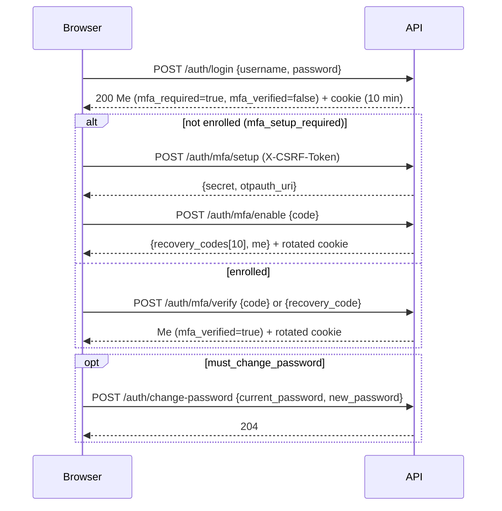

# Jenderal Cloud OS API guide

This is the human-oriented guide to the Jenderal Cloud OS REST API. The machine-readable contract is
[`packages/api-contracts/openapi.yaml`](../packages/api-contracts/openapi.yaml) (OpenAPI 3.1,
validated with Redocly). The Go handlers in `internal/modules/**` and the route table in
[`internal/app/api.go`](../internal/app/api.go) are the source of truth.

Related documents: [architecture](architecture.md) · [security](security.md) ·
[workspaces](workspace.md) · [GPU](gpu.md) · [backup & restore](backup-restore.md) ·
[agent protocol](agent-protocol.md) (internal API ↔ agent protocol, not exposed to browsers).

## 1. Conventions

| Topic | Rule |
|---|---|
| Base path | `/api/v1` for the application, `/health/live` and `/health/ready` for probes. Unknown `/api/...` paths return a JSON 404. |
| Transport | HTTPS through Caddy (`APP_BASE_URL`, e.g. `https://itk-cloud.local`). The API itself listens on `API_HOST:API_PORT` (default `127.0.0.1:8080`) and must not be exposed directly. |
| Content type | `application/json; charset=utf-8`. Uploads use `multipart/form-data`; downloads `application/octet-stream`. |
| Request bodies | Decoded strictly: unknown fields → `400 bad_request`, a second JSON value → 400, wrong `Content-Type` → `415`. JSON bodies are limited to **1 MiB**; uploads are limited per file by `UPLOAD_MAX_BYTES`. |
| Success envelope | `{"data": <object or array>}` |
| List envelope | `{"data": [...], "meta": {"page": 1, "per_page": 20, "total": 57}}` |
| Error envelope | `{"error": {"code": "...", "message": "...", "details": {"field": "msg"}, "request_id": "..."}}` |
| IDs | UUIDs (audit log entries use a 64-bit integer). A malformed UUID in a path returns 404. |
| Time | RFC 3339 timestamps in UTC; the UI converts to local time. |
| Sizes | Bytes (`*_bytes`); CPU in millicores (`cpu_millis`, 1000 = one core). |
| Request ID | Every response has `X-Request-ID`. A client-supplied `X-Request-ID` (8–64 chars `[A-Za-z0-9-]`) is reused; it also appears in logs, audit entries and error bodies. |
| Timeouts | Non-streaming requests are bounded to 60 s. Streaming routes (WebSocket, upload, download, app proxy, image pull, emergency stop) manage their own deadlines. |
| Security headers | API responses carry `X-Content-Type-Options: nosniff`, `X-Frame-Options: DENY`, `Referrer-Policy: no-referrer`, `Content-Security-Policy: default-src 'none'; frame-ancestors 'none'`, `Cross-Origin-Resource-Policy: same-origin`, and `Cache-Control: no-store` on JSON. |

## 2. Authentication, sessions, CSRF and MFA

### 2.1 Session cookie

`POST /api/v1/auth/login` with `{"username": "...", "password": "..."}` (username or email,
case-insensitive) sets the cookie:

```
itk_session=<43-char random token>; Path=/; HttpOnly; SameSite=Lax; Secure (when COOKIE_SECURE)
```

- The token is 32 random bytes; only its SHA-256 hash is stored (`sessions.token_hash`).
- Absolute lifetime `SESSION_TTL_HOURS` (default 12 h); idle timeout `SESSION_IDLE_MINUTES`
  (default 120 min). A session awaiting MFA expires after 10 minutes.
- The session is rotated (old one revoked, new cookie issued) when MFA is enabled or
  verified, preventing session fixation.
- Changing the password revokes all *other* sessions; a password reset, suspension, role
  change or admin MFA reset revokes *all* sessions of the user.
- `GET /api/v1/auth/sessions` lists own sessions; `DELETE /api/v1/auth/sessions/{id}` revokes one.

### 2.2 CSRF protection (double check)

For `POST`, `PUT`, `PATCH`, `DELETE`:

1. If an `Origin` header is present it must equal the origin of `APP_BASE_URL`
   (scheme + host + port), otherwise `403 csrf_failed`.
2. If the request carries a valid session, the header `X-CSRF-Token` must equal the
   per-session token (constant-time comparison), otherwise `403 csrf_failed`.

Obtain the token from `GET /api/v1/auth/me` (`csrf_token`) or the login/MFA responses. The
only exempt paths are the workspace app proxy routes (`/api/v1/workspaces/{id}/proxy/...`),
which are served exclusively on the separate `APP_PROXY_ORIGIN` (see §9).

### 2.3 MFA (TOTP)

- Roles with `requires_mfa` (built-in: `super_admin`, `admin`) must use MFA while the setting
  `security.require_mfa_for_admins` is on. Any user who enrolled MFA must always complete it.
- Login response (`Me`) fields: `mfa_required`, `mfa_verified`, `mfa_enrolled`,
  `mfa_setup_required`, `must_change_password`.
- While MFA is pending, only these endpoints are reachable; others return `403 mfa_required`:
  `GET /auth/me`, `POST /auth/logout`, `POST /auth/mfa/verify`, `POST /auth/mfa/setup`,
  `POST /auth/mfa/enable`.
- While a password change is required (new users with a temporary password), the same set
  plus `POST /auth/change-password` is reachable; others return `403 password_change_required`.



TOTP: SHA-1, 6 digits, 30 s period, ±1 step tolerance; a time step can be used only once
(`mfa_methods.last_used_step`). Recovery codes (10, format `XXXXX-XXXXX`) are stored as
SHA-256 hashes and consumed on use. `POST /auth/mfa/disable` needs password + TOTP code and
is refused when the role requires MFA.

### 2.4 Password reset

- Self service: `POST /auth/forgot-password {email}` always answers `202`
  (`email_delivery` tells the UI whether SMTP is configured). With SMTP, a link
  `<APP_BASE_URL>/reset-password#token=<token>` valid for 1 hour is emailed.
- Without SMTP: an administrator with `users.reset_password` calls
  `POST /users/{id}/reset-password` and hands the returned `reset_link` to the user.
- `POST /auth/reset-password {token, password}` consumes the token (single use), clears the
  lockout and revokes all sessions.
- Password policy: 12–256 characters, at least three of lowercase, uppercase, digits, symbols.

## 3. Authorization model

- **Deny by default.** Every handler checks a permission and/or an ownership policy.
- **Permissions** are granular keys (e.g. `workspaces.create`) granted through roles; see
  `GET /api/v1/permissions` and [security.md §4.4](security.md#44-authorization).
- **Ranks**: roles have a rank (super_admin 100, admin 80, lecturer 40, assistant 30,
  student 10). Users can only grant roles and manage users of a *lower* rank (equal rank is
  allowed only with `roles.manage`).
- **No existence leaks**: when the caller cannot even view a resource (workspace, project,
  container, database, user, GPU allocation), the API returns `404`, not `403`. A `403` means
  the resource is visible but the action is not allowed.
- **Workspace access levels** (`view` < `operate` < `edit`, plus `manage`), see
  [workspace.md §6](workspace.md#6-members-and-access-levels).
- **Emergency access**: holders of `workspaces.access_all` (super_admin) may reach another
  user's workspace data (files, terminal, container create/delete) only with the header
  `X-Access-Reason: <justification ≥ 10 chars>`. Each access is audited as
  `workspace.emergency_access` with the reason. Without the header: `403 emergency_reason_required`.
  Workspace web apps (app proxy) are never available through emergency access.

## 4. Pagination, sorting, search and filters

Paginated list endpoints (`/users`, `/projects`, `/workspaces`, `/containers`,
`/notifications`, `/admin/audit-logs`, `/admin/backups`) accept:

| Parameter | Meaning |
|---|---|
| `page` | 1-based page (1–100000, default 1) |
| `per_page` | 1–100 (default 20) |
| `sort` | Field name from the endpoint's allowlist; prefix `-` for descending (e.g. `-created_at`). Unknown fields → 422. |
| `q` | Case-insensitive substring search (≤ 100 chars); `%`/`_` are escaped. |

Endpoint-specific filters (e.g. `status`, `role`, `mine=true`, `owner_id`, `project_id`,
`workspace_id`, `unread=true`, `type`, audit `actor_id/action/resource_type/resource_id/outcome/from/to`)
are listed in the OpenAPI contract. Some small collections (roles, templates, images, quotas,
GPU requests/allocations, alerts) return plain arrays without `meta`.

## 5. Errors

| HTTP | `code` | Typical cause |
|---|---|---|
| 400 | `bad_request` | Malformed JSON, unknown field, empty body, invalid multipart |
| 400 | `invalid_token` | Password reset token invalid/used/expired |
| 401 | `unauthorized` | Missing/expired/revoked session |
| 401 | `invalid_credentials` | Wrong username or password (identical for unknown users) |
| 403 | `forbidden` | Permission or access level missing |
| 403 | `csrf_failed` | Foreign `Origin` or missing/invalid `X-CSRF-Token` |
| 403 | `mfa_required` / `password_change_required` | Session not yet allowed to use the API |
| 403 | `account_suspended` | Login of a suspended account |
| 403 | `emergency_reason_required` | Emergency access without `X-Access-Reason` |
| 404 | `not_found` | Resource missing **or not visible to the caller** |
| 409 | `conflict` | Invalid state transition, job already in progress, duplicate, stale editor write |
| 410 | `terminal_session_ended` | Terminal session closed/expired |
| 413 | `payload_too_large` | Body, upload or editor content too large |
| 415 | `unsupported_media_type` / `unsupported_file_type` / `binary_file` | Wrong content type; file not editable in the browser |
| 422 | `validation_failed` | Field errors in `details` |
| 422 | `quota_exceeded` | Quota package limit (workspaces, containers, CPU, memory, storage, databases, terminals, GPU) |
| 423 | `account_locked` | Too many failed logins |
| 429 | `rate_limited` | Rate limit hit |
| 500 | `internal_error` | Unexpected error (details only in server logs, correlated by `request_id`) |
| 502 | `app_unreachable` | App proxy: nothing listens on the workspace port |
| 503 | `unavailable` | Host agent down, Redis down during login, feature not configured |
| 503 | `insufficient_capacity` | Host memory/CPU capacity check failed at start |
| 507 | `quota_exceeded` | Workspace volume is full (file write/upload) |

## 6. Idempotency

`POST /api/v1/workspaces`, `POST /api/v1/containers` and `POST /api/v1/databases` accept an
`Idempotency-Key` header (8–100 characters). For the same user and key within 24 hours:

- same method and path → the stored 2xx response is replayed with `Idempotent-Replay: true`
  (the request is not executed again);
- different method or path → `409 conflict`.

Only successful (2xx) JSON responses are stored; failed requests may be retried with the same
key. Keys are pruned after 2 days. Internally, background jobs carry their own idempotency
keys (e.g. `workspace.provision:<id>`), so provisioning is never scheduled twice.

## 7. Asynchronous operations and polling

Operations that touch the host run in background jobs and return **202 Accepted** with the
current resource representation:

| Request | Job kind(s) | Poll |
|---|---|---|
| `POST /workspaces` | `workspace.provision` | `GET /workspaces/{id}` until `status` is `ready` (or `failed`) |
| `POST /workspaces/{id}/start\|stop\|restart\|suspend\|retry`, `DELETE /workspaces/{id}` | `workspace.start/stop/restart/provision/delete` | `status` and `pending_job` (null when idle); `GET /workspaces/{id}/jobs` for attempts and `last_error` |
| `POST /containers`, `POST /containers/{id}/start\|stop\|restart`, `DELETE /containers/{id}` | `container.create/start/stop/restart/remove` | `GET /containers/{id}` |
| `POST /databases`, `DELETE /databases/{id}` | `database.provision/delete` | `GET /databases/{id}` until `ready` |
| `POST /admin/backups` | `backup.run` (one per kind) | `GET /admin/backups` (`status`) |
| `POST /admin/backups/{id}/restore` | `backup.restore` (single attempt) | `GET /admin/backups` (`restore_status`) |

While a workspace job is queued or running, further lifecycle actions on the same workspace
return `409` ("Another operation ... is in progress"). The web console polls every 3 s while
something is pending. Jobs retry with exponential backoff (5 s, 20 s, 80 s, ... capped at
30 min); after the last attempt they become `dead` and the resource is marked failed (see
[architecture.md §6](architecture.md#6-background-jobs)).

## 8. Rate limits

Fixed-window counters in Redis (`itk:rl:*`):

| Endpoint | Limit | When Redis is unavailable |
|---|---|---|
| `POST /auth/login` | 30 per IP per 10 min **and** 10 per username per 15 min (username counter is reset on success) | Fails closed: `503` |
| `POST /auth/forgot-password` | 10 per IP per hour (429); 3 per email per hour (silently accepted with 202) | 429 |
| `POST /auth/reset-password` | 20 per IP per hour | 429 |
| `POST /auth/change-password` | 10 per user per 15 min | 429 |
| `POST /auth/mfa/enable`, `POST /auth/mfa/verify` | 10 per user per 10 min | 429 |

Independently of rate limits, after `security.login_max_attempts` (default 5) wrong passwords
the account is locked for `security.lockout_minutes` (default 15) and login returns `423`.
The client IP is the TCP peer; `X-Forwarded-For` is honoured only when the peer is loopback
(the local Caddy).

## 9. Terminal WebSocket and app proxy

**Terminal.** `POST /workspaces/{id}/terminals` creates a session (`pending`) and returns
`websocket_path`. Open `wss://<APP_BASE_URL host>/api/v1/terminals/{id}/ws` with the session
cookie (the browser sends it automatically; the `Origin` must be the console origin). Binary
frames carry terminal bytes; text frames carry `{"type":"resize","cols":N,"rows":N}` or
`{"type":"ping"}`. Each (re)connect re-validates the user, workspace access and session
expiry and starts a **new shell**. See [architecture.md §8](architecture.md#8-terminal-relay).

**App proxy.** Web apps inside a workspace (JupyterLab, dev servers) are reachable at
`<APP_PROXY_ORIGIN>/api/v1/workspaces/{id}/proxy/{port}/` for the owner and editors. The
routes answer only when the request host is `APP_PROXY_ORIGIN` (404 on the console origin,
503 when unset). See [architecture.md §9](architecture.md#9-networking).

## 10. Endpoint index and required permissions

"Access" refers to the workspace access level ([workspace.md §6](workspace.md#6-members-and-access-levels))
or project role. *auth* = any authenticated session that passed MFA/password-change gates.

### Health & public

| Method | Path | Requirement |
|---|---|---|
| GET | `/health/live` | public |
| GET | `/health/ready` | public (503 if DB/Redis down or migrations pending) |
| GET | `/api/v1/config` | public |
| POST | `/api/v1/auth/login` | public (rate limited) |
| POST | `/api/v1/auth/forgot-password` | public (rate limited) |
| POST | `/api/v1/auth/reset-password` | public (reset token) |

### Auth (own account)

| Method | Path | Requirement |
|---|---|---|
| POST | `/api/v1/auth/logout` | session (allowed while MFA pending) |
| GET | `/api/v1/auth/me` | session (allowed while MFA pending) |
| POST | `/api/v1/auth/change-password` | session (allowed while password change pending) |
| POST | `/api/v1/auth/mfa/setup` · `/mfa/enable` · `/mfa/verify` | session (allowed while MFA pending) |
| POST | `/api/v1/auth/mfa/disable` | auth; refused if role requires MFA |
| GET | `/api/v1/auth/sessions` | auth |
| DELETE | `/api/v1/auth/sessions/{id}` | auth, own session |

### Dashboard

| Method | Path | Requirement |
|---|---|---|
| GET | `/api/v1/dashboard` | auth (`platform` block with `monitoring.view_host`) |
| GET | `/api/v1/me/usage` | auth |

### Users, roles, quotas

| Method | Path | Requirement |
|---|---|---|
| GET | `/api/v1/users` | `users.view` |
| POST | `/api/v1/users` | `users.create`; granted roles must be below own rank (`users.assign_roles`), equal with `roles.manage` |
| GET | `/api/v1/users/lookup?q=` | `users.lookup` or `users.view` |
| GET | `/api/v1/users/{id}` | self or `users.view` (else 404) |
| PATCH | `/api/v1/users/{id}` | self (full_name only) or `users.update` on a lower-rank user; `roles` needs `users.assign_roles`/`roles.manage`, never on self |
| POST | `/api/v1/users/{id}/suspend` · `/activate` | `users.suspend`, lower-rank target, not self |
| POST | `/api/v1/users/{id}/reset-password` | `users.reset_password`, lower-rank target, not self |
| POST | `/api/v1/users/{id}/reset-mfa` | `users.reset_password`, lower-rank target, not self, reason |
| GET | `/api/v1/users/{id}/usage` | self or `users.view` |
| GET | `/api/v1/roles` | `roles.view`, `users.assign_roles` or `users.view` |
| POST · PATCH · DELETE | `/api/v1/roles`, `/api/v1/roles/{id}` | `roles.manage`; only roles below own rank; `super_admin` immutable; built-ins not deletable |
| GET | `/api/v1/permissions` | `roles.view` or `roles.manage` |
| GET | `/api/v1/quotas` | `quotas.view` or `quotas.manage` |
| POST · PATCH · DELETE | `/api/v1/quotas`, `/api/v1/quotas/{id}` | `quotas.manage` (default/assigned packages cannot be deleted) |

### Projects

| Method | Path | Requirement |
|---|---|---|
| GET | `/api/v1/projects` | auth (memberships; all with `projects.view_all`/`projects.manage_all`) |
| POST | `/api/v1/projects` | `projects.create` (`quota_key` needs `quotas.manage`) |
| GET | `/api/v1/projects/{id}` | project viewer, `projects.view_all` or `projects.manage_all` |
| PATCH | `/api/v1/projects/{id}` | maintainer (archive: owner; quota: `quotas.manage`) |
| DELETE | `/api/v1/projects/{id}` | owner or `projects.manage_all`; no live workspaces/databases |
| POST | `/api/v1/projects/{id}/members` | maintainer (maintainer role changes: owner) |
| DELETE | `/api/v1/projects/{id}/members/{userId}` | maintainer, or self; owner cannot be removed |
| GET | `/api/v1/projects/{id}/activity` | viewer |

### Templates & images

| Method | Path | Requirement |
|---|---|---|
| GET | `/api/v1/templates`, `/api/v1/templates/{id}` | `templates.view` or `templates.manage` (`?all=true` and inactive templates: `templates.manage`) |
| POST · PATCH | `/api/v1/templates`, `/api/v1/templates/{id}` | `templates.manage` |
| GET | `/api/v1/images` | `images.view` or `images.manage` |
| POST · PATCH | `/api/v1/images`, `/api/v1/images/{id}` | `images.manage` |
| POST | `/api/v1/images/{id}/pull` | `images.manage` |

### Workspaces

| Method | Path | Requirement |
|---|---|---|
| GET | `/api/v1/workspaces` | `workspaces.view_own`, `view_all` or `manage_all` (rows filtered by visibility) |
| POST | `/api/v1/workspaces` | `workspaces.create` (+ `workspaces.native` for native, + `workspaces.manage_all` for `owner_id`); idempotent |
| GET | `/api/v1/workspaces/{id}` | view |
| PATCH | `/api/v1/workspaces/{id}` | manage |
| DELETE | `/api/v1/workspaces/{id}` | owner with `workspaces.delete`, or manage + `workspaces.manage_all` |
| POST | `/api/v1/workspaces/{id}/start` · `/stop` · `/restart` | operate (starting a suspended workspace: `workspaces.manage_all`) |
| POST | `/api/v1/workspaces/{id}/suspend` | manage + `workspaces.manage_all`, reason |
| POST | `/api/v1/workspaces/{id}/retry` | manage |
| GET | `/api/v1/workspaces/{id}/jobs` | view |
| POST | `/api/v1/workspaces/{id}/members` | manage |
| DELETE | `/api/v1/workspaces/{id}/members/{userId}` | manage |

### Files (all: `files.manage` + edit access; `X-Access-Reason` for emergency access)

| Method | Path | Notes |
|---|---|---|
| GET | `/api/v1/workspaces/{id}/files?path=` | list (max 5000 entries) |
| DELETE | `/api/v1/workspaces/{id}/files?path=&recursive=` | audited |
| GET | `/api/v1/workspaces/{id}/files/stat?path=` | |
| GET | `/api/v1/workspaces/{id}/files/content?path=` | text editor read (≤ `EDITOR_MAX_BYTES`) |
| PUT | `/api/v1/workspaces/{id}/files/content` | atomic write, optimistic `expected_mod_time` |
| POST | `/api/v1/workspaces/{id}/files/upload?path=&overwrite=` | multipart, streamed, audited |
| GET | `/api/v1/workspaces/{id}/files/download?path=` | streamed |
| POST | `/api/v1/workspaces/{id}/files/mkdir` | |
| PATCH | `/api/v1/workspaces/{id}/files/rename` | audited |

### Terminals & app proxy

| Method | Path | Requirement |
|---|---|---|
| POST | `/api/v1/workspaces/{id}/terminals` | `terminals.open` + edit (emergency: reason header); quota `max_terminal_sessions` |
| GET | `/api/v1/terminals` | auth (own sessions) |
| DELETE | `/api/v1/terminals/{id}` | own session |
| GET (WebSocket) | `/api/v1/terminals/{id}/ws` | own session + `terminals.open` + edit (re-checked on every connect) |
| any | `/api/v1/workspaces/{id}/proxy/{port}[/...]` | edit as owner/editor (no emergency); only on `APP_PROXY_ORIGIN` |

### Containers

| Method | Path | Requirement |
|---|---|---|
| GET | `/api/v1/containers` | auth (rows filtered; all with `containers.manage_all`/`workspaces.view_all`/`manage_all`) |
| POST | `/api/v1/containers` | `containers.create` + edit; idempotent |
| GET | `/api/v1/containers/{id}` | view (or `containers.manage_all`) |
| DELETE | `/api/v1/containers/{id}` | edit; not the primary container |
| GET | `/api/v1/containers/{id}/logs` | operate (or `containers.manage_all`) |
| POST | `/api/v1/containers/{id}/start` · `/stop` · `/restart` | operate (or `containers.manage_all`) **and** `containers.stop` or `containers.manage_all` |

### Databases

| Method | Path | Requirement |
|---|---|---|
| GET | `/api/v1/databases` | auth (own projects; all with `databases.manage_all`/`projects.view_all`/`projects.manage_all`) |
| POST | `/api/v1/databases` | `databases.create` or `databases.manage_all`, plus project maintainer; idempotent |
| GET | `/api/v1/databases/{id}` | project member (not viewer) or `databases.manage_all` |
| DELETE | `/api/v1/databases/{id}?confirm=<db_name>` | maintainer + (`databases.delete` or `databases.manage_all`) |
| POST | `/api/v1/databases/{id}/credentials/reset` | maintainer or `databases.manage_all` |

### GPU

| Method | Path | Requirement |
|---|---|---|
| GET | `/api/v1/gpu/devices` | `gpu.view`, `gpu.manage` or `gpu.approve` (processes: + `gpu.manage`/`gpu.approve`/`monitoring.view_host`) |
| PATCH | `/api/v1/gpu/devices/{id}` | `gpu.manage` |
| GET | `/api/v1/gpu/requests` | `gpu.view`, `gpu.request` or `gpu.approve` (all requests with `gpu.approve`) |
| POST | `/api/v1/gpu/requests` | `gpu.request` + edit access to the workspace + quota `gpu_allowed` + `GPU_ENABLED` |
| POST | `/api/v1/gpu/requests/{id}/approve` | `gpu.approve` (own request: `gpu.manage`) |
| POST | `/api/v1/gpu/requests/{id}/reject` | `gpu.approve` |
| POST | `/api/v1/gpu/requests/{id}/cancel` | requester |
| GET | `/api/v1/gpu/allocations` | `gpu.view`, `gpu.approve` or `gpu.manage` (all with approve/manage/`monitoring.view_host`) |
| POST | `/api/v1/gpu/allocations/{id}/release` | allocation user, `gpu.approve` or `gpu.manage` |

### Monitoring

| Method | Path | Requirement |
|---|---|---|
| GET | `/api/v1/monitoring/host` | `monitoring.view_host` |
| GET | `/api/v1/monitoring/workspaces/{id}` | operate |
| GET | `/api/v1/monitoring/gpu` | `monitoring.view_host` or `gpu.view` |
| GET | `/api/v1/monitoring/history?scope=&ref=&range=` | host: `monitoring.view_host`; gpu: + `gpu.view`; workspace/container: operate or `monitoring.view_host` |
| GET | `/api/v1/monitoring/alerts` | `monitoring.view_host` |
| POST | `/api/v1/monitoring/alerts/{id}/ack` | `monitoring.view_host` |
| GET | `/api/v1/monitoring/services` | `monitoring.view_host` or `host.operations.view` |
| GET | `/api/v1/monitoring/jobs?status=` | `monitoring.view_host` |
| POST | `/api/v1/monitoring/jobs/{id}/retry` | `settings.manage` or `workspaces.manage_all` |

### Notifications & announcements

| Method | Path | Requirement |
|---|---|---|
| GET | `/api/v1/notifications`, `/api/v1/notifications/unread-count` | auth (own) |
| POST | `/api/v1/notifications/read-all`, `/api/v1/notifications/{id}/read` | auth (own) |
| GET | `/api/v1/announcements` | auth (`?all=true` with `announcements.manage`) |
| POST · DELETE | `/api/v1/announcements`, `/api/v1/announcements/{id}` | `announcements.manage` |

### Administration

| Method | Path | Requirement |
|---|---|---|
| GET | `/api/v1/admin/audit-logs` | `audit.view` |
| GET | `/api/v1/admin/agent/status` | `agent.view` or `host.operations.view` |
| GET · PATCH | `/api/v1/admin/settings` | `settings.manage` |
| GET · POST | `/api/v1/admin/backups` | `backup.manage` |
| POST | `/api/v1/admin/backups/{id}/restore` | `backup.manage`, typed file name, age private key, reason |
| POST | `/api/v1/admin/host/emergency-stop` | `host.operations.execute`, phrase `STOP ALL WORKLOADS`, reason ≥ 10 chars |

## 11. Example session (curl)

```bash
BASE=https://itk-cloud.local
JAR=$(mktemp)
# Log in (Origin is optional for non-browser clients, but if sent it must match).
curl -sk -c $JAR -H 'Content-Type: application/json' \
  -d '{"username":"mhs1","password":"..."}' $BASE/api/v1/auth/login
CSRF=$(curl -sk -b $JAR $BASE/api/v1/auth/me | jq -r .data.csrf_token)
# Create a workspace idempotently.
curl -sk -b $JAR -H "X-CSRF-Token: $CSRF" -H 'Content-Type: application/json' \
  -H "Idempotency-Key: $(uuidgen)" \
  -d '{"name":"Praktikum Linux","template_key":"ubuntu-dev"}' $BASE/api/v1/workspaces
```
