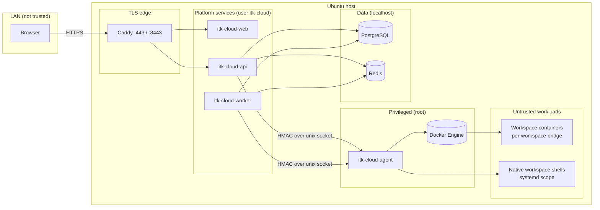
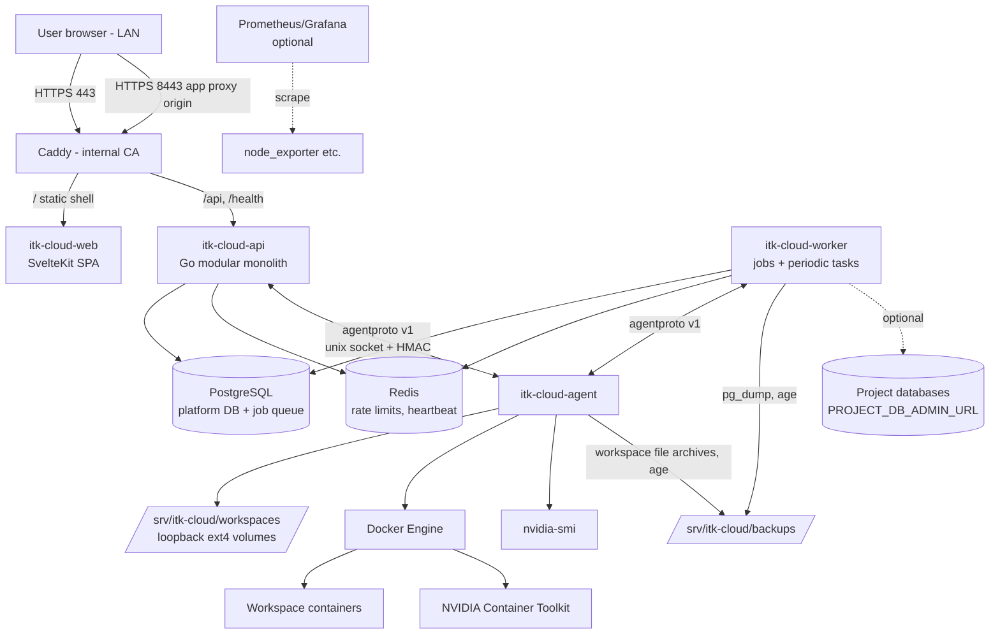
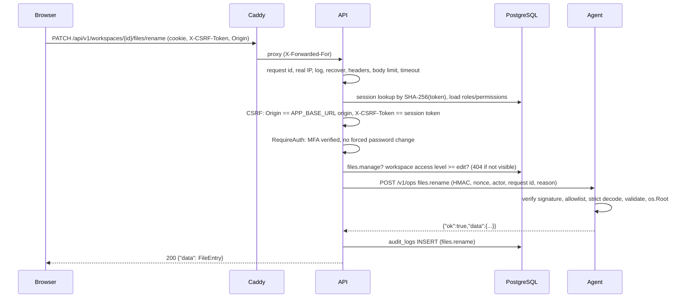
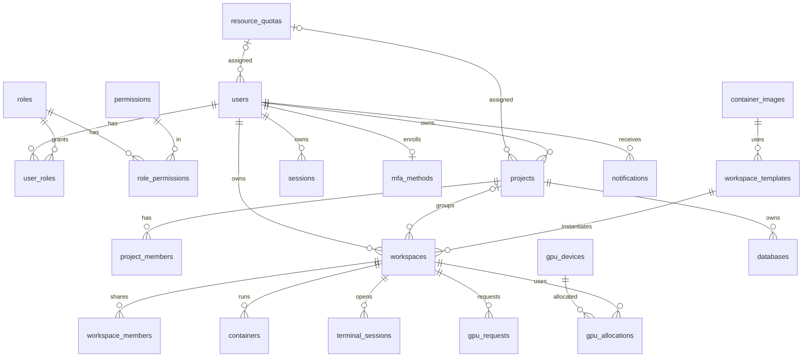
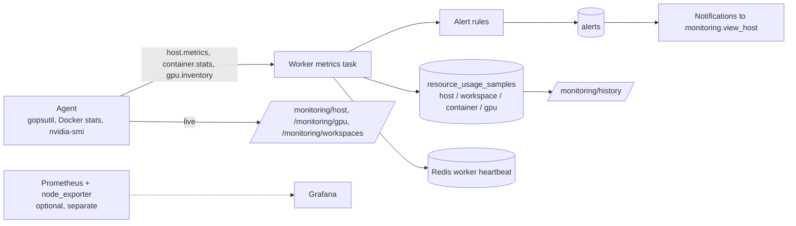

# ITK Cloud architecture

ITK Cloud is a single-server private cloud for the Informatics & Computer Engineering
laboratory. It runs **natively on Ubuntu Server 24.04 LTS** (systemd services, no container
for the platform itself); Docker Engine is used only as the runtime for user container
workspaces. This document describes the implemented architecture. Decisions are recorded in
[docs/adr](adr/README.md).

Related: [security](security.md) · [agent protocol](agent-protocol.md) ·
[workspaces](workspace.md) · [API](api.md) · [installation](installation.md) ·
[operations](operations.md).

## 1. Components

| Component | Binary / source | Runs as | Listens on | Responsibility |
|---|---|---|---|---|
| Web console | `apps/web` (SvelteKit 3.1, Svelte 5, `@sveltejs/adapter-node`, `ssr = false`) | `itk-cloud` (systemd `itk-cloud-web.service`) | localhost only (behind Caddy) | Serves the client-rendered console shell and static assets. All data comes from the API. |
| API | `apps/api` → `itk-cloud-api` | `itk-cloud`; refuses to start as root when `APP_ENV=production` | `API_HOST:API_PORT` (default `127.0.0.1:8080`) | REST API `/api/v1`, health probes, terminal WebSocket relay, workspace app proxy. |
| Worker | `apps/worker` → `itk-cloud-worker` | `itk-cloud`; refuses root in production; refuses to start with pending migrations | none | Background jobs (provisioning, lifecycle, backups, restores, project databases) and periodic tasks (metrics, alerts, idle stop, GPU reconcile, retention). |
| Host agent | `apps/agent` → `itk-cloud-agent` | `root` (loop mounts, chown, Docker socket, `useradd`) | Unix socket `AGENT_SOCKET_PATH` (default `/run/itk-cloud/agent.sock`, mode 0660, group `AGENT_SOCKET_GROUP`=`itk-cloud`) | The only component that touches the host: storage, Docker, PTYs, GPU discovery, workspace file I/O, workspace backups. Executes only allow-listed operations. |
| Admin CLI | `apps/cli` → `itkctl` | operator (root or `itk-cloud`) | none | Migrations, first admin, secret generation, backup keys, decrypt, offline platform DB restore, health check. |
| PostgreSQL | distribution package | `postgres` | `127.0.0.1:5432` (plus an address reachable from workspace networks when project databases are enabled, see §9.4) | Platform database; optionally project databases (separate DB + role each). |
| Redis | distribution package | `redis` | `127.0.0.1:6379` | Rate limiting, worker heartbeat. |
| Caddy | distribution package | `caddy` | `:443` (console), `:8443` (app proxy origin) | TLS termination with its internal CA, reverse proxy to web and API. |
| Docker Engine | Docker CE (Engine API ≥ 1.44) | `root` | `/var/run/docker.sock` (agent only) | Runs workspace containers. |
| NVIDIA driver + Container Toolkit | optional | — | — | GPU access inside approved containers. |

Shared code: `internal/platform/**` (config, db, jobs, httpx, authz, crypto, logging,
redisx, idempotency), `internal/modules/**` (business modules), `packages/agentproto`
(versioned agent protocol, used by both sides).

## 2. Trust boundaries

Spec §4.3 is implemented as follows:

| Boundary / rule (spec §4.3) | Implementation |
|---|---|
| Browser never talks to Docker Engine | Only the agent opens `/var/run/docker.sock`. The API/worker have no Docker client; the Docker socket is never mounted into containers (verified by `TestContainerWorkspaceLifecycle`). |
| Backend accepts no arbitrary shell command | There is no exec endpoint. The terminal opens a fixed login shell (`/bin/bash -l` or `/bin/sh -l`) inside the user's own container/scope. |
| Agent accepts only structured, allow-listed operations | `agentproto.Operations` allowlist, strict JSON decoding (`DisallowUnknownFields`), per-payload `Validate()`, streaming ops only on their endpoints. |
| User containers are untrusted workloads | Non-root uid 1000, `CapDrop: ALL`, `no-new-privileges`, AppArmor `docker-default`, seccomp, PID/CPU/memory limits, private IPC, per-workspace network, loopback-only port publishing. |
| User data not readable by other users | Workspace access policy (`internal/modules/workspaces/access.go`), 404 for no-access, file access via `os.Root` confined to the workspace data directory, workspace-level edit access required for files/terminal/apps. |
| API and agent authenticate each other | Unix socket permissions (0660, group `itk-cloud`) + HMAC-SHA256 request signatures with timestamp window and nonce replay cache. |
| High-risk operations need special permission and audit | e.g. `host.operations.execute` + confirmation phrase for emergency stop, `workspaces.access_all` + `X-Access-Reason` for emergency access, `backup.manage` + typed file name + private key for restore; all audited. |



## 3. System overview



## 4. Request flow

Middleware chain (outermost first, `internal/app/api.go`): request ID → real IP (trust
`X-Forwarded-For` only from loopback) → JSON access log → panic recovery → security headers →
body limit (1 MiB, streaming routes excluded) → 60 s timeout (streaming excluded) → session
authentication → CSRF. Then `RequireAuth` (with the MFA/password-change gates) wraps every
private route, and each handler performs its own permission/ownership checks.



## 5. Modular monolith

The API and worker are two entry points over the same Go module set; modules talk to each
other through Go APIs, not the network ([ADR 0001](adr/0001-modular-monolith-go.md)).

| Module (`internal/modules/…`) | Responsibility | Main tables |
|---|---|---|
| `auth` | Login, sessions, CSRF, TOTP MFA, password change/reset | `sessions`, `mfa_methods`, `password_reset_tokens` |
| `users` | Accounts, role assignment by rank, suspension, admin resets, bootstrap admin | `users`, `user_roles` |
| `rbac` | Roles, permissions, access loading | `roles`, `permissions`, `role_permissions` |
| `projects` | Projects, membership roles (owner/maintainer/member/viewer), activity | `projects`, `project_members` |
| `workspaces` | Templates, lifecycle state machine, access policy, members, lifecycle jobs, idle stop, usage refresh | `workspace_templates`, `workspaces`, `workspace_members`, `containers` |
| `containers` | Container API on top of the workspace service | `containers` |
| `images` | Image allowlist, pull/check | `container_images` |
| `files` | File manager (proxy to agent `files.*`) | — |
| `terminals` | Terminal sessions and WebSocket relay | `terminal_sessions` |
| `appproxy` | Authenticated reverse proxy to workspace apps | — |
| `databases` | Project PostgreSQL databases and credentials | `databases` |
| `gpu` | Inventory sync, requests, approvals, allocations, reconcile | `gpu_devices`, `gpu_requests`, `gpu_allocations` |
| `resources` | Quota packages, usage aggregation, quota and host-capacity checks | `resource_quotas` |
| `monitoring` | Metric sampling, history, alert rules, service status, failed jobs | `resource_usage_samples`, `alerts` |
| `notifications` | In-app notifications, announcements | `notifications`, `announcements` |
| `audit` | Append-only audit entries and queries | `audit_logs` |
| `backups` | Encrypted backups, retention, restores | `backup_jobs` |
| `settings` | Typed, schema-validated platform settings | `platform_settings` |
| `agent` | Agent facade (actor/request ID/reason on every call), node status | `agent_nodes` |
| `hostops` | Emergency stop | — |
| `dashboard` | Dashboard summary, public config | — |
| `mail` | SMTP sender (optional) | — |

## 6. Background jobs

Durable queue in PostgreSQL (`internal/platform/jobs`, [ADR 0002](adr/0002-postgres-job-queue.md)):

- **Transactional enqueue.** Jobs are inserted into `background_jobs` in the same transaction
  as the domain change (e.g. workspace row + provision job), so a job exists iff the change
  committed.
- **Claiming.** `UPDATE ... WHERE id = (SELECT id ... WHERE status='queued' AND run_at <= now()
  ORDER BY run_at, created_at FOR UPDATE SKIP LOCKED LIMIT 1) RETURNING ...` — concurrent
  workers never claim the same job. 4 worker goroutines, 1 s poll interval.
- **Timeouts.** Each job runs with a 30 min context. A minute ticker re-queues jobs stuck in
  `running` for more than 35 minutes (worker crash).
- **Retries.** Exponential backoff `5 s × 4^(attempt-1)`, capped at 30 min (5 s, 20 s, 80 s,
  320 s, 1280 s ...). `max_attempts`: workspace jobs 5, container jobs 4, backup runs 3,
  restores 1, database jobs 5 (default).
- **Permanent errors.** `jobs.Permanent(err)` (e.g. image not available, bad payload)
  skips retries.
- **Dead jobs.** After the last attempt the job becomes `dead` and `OnDead` marks the
  resource (`workspaces.status='failed'` for provisioning, `'failed'` with reason for
  deletion, `status_reason` for start/stop, `databases.status='failed'`) and notifies the
  owner. Dead jobs are listed in `GET /monitoring/jobs` and can be re-queued with
  `POST /monitoring/jobs/{id}/retry`.
- **Idempotency.** `background_jobs.idempotency_key` is unique; enqueueing with an existing
  key returns the existing job (`workspace.provision:<id>`, `workspace.delete:<id>`,
  `database.provision:<id>`, `backup.scheduled:<day>:<kind>`). Handlers are written to be
  re-runnable: they re-read state and skip work already done (e.g. the agent's
  `container.create` returns the existing container with the same ITK label).
- **Serialisation per resource.** API handlers refuse a new lifecycle action while a
  queued/running job exists for the workspace or container (`409`).
- **Correlation.** Job handlers run with a system principal acting for the requester and
  request ID `job-<job id>`, which is forwarded to the agent and written to audit entries.

Registered job kinds (14): `workspace.provision|start|stop|restart|delete`,
`container.create|start|stop|restart|remove`, `database.provision|delete`,
`backup.run|restore`.

### Provisioning job flow

```mermaid
sequenceDiagram
    participant B as Browser
    participant A as API
    participant DB as PostgreSQL
    participant W as Worker
    participant AG as Agent
    participant D as Docker
    B->>A: POST /workspaces (Idempotency-Key)
    A->>DB: BEGIN; lock owner row; quota checks; INSERT workspace(requested) + primary container row; INSERT job workspace.provision:<id>; audit; COMMIT
    A-->>B: 202 {status: requested, pending_job: workspace.provision}
    W->>DB: claim job (FOR UPDATE SKIP LOCKED)
    W->>DB: status = provisioning
    W->>AG: workspace.provision (create disk.img, mkfs.ext4, mount, chown)
    W->>AG: image.ensure (inspect / pull)
    W->>AG: container.create (hardened config, per-workspace network)
    AG->>D: create network itk-ws-<id>, create container itk-<container id>
    W->>DB: container runtime_id, status stopped; workspace status = ready; audit; notify owner
    B->>A: GET /workspaces/{id} (poll)
    A-->>B: status ready
```

### Periodic tasks (worker)

| Task | Interval | What it does |
|---|---|---|
| `heartbeat` | 30 s | Sets Redis `itk:worker:heartbeat` (TTL 90 s) — used by service status and the `service_down` alert. |
| `agent_heartbeat` | 30 s | `agent.info` → upserts `agent_nodes` (online / degraded / offline). |
| `metrics` | `monitoring.sample_interval_seconds` (default 30 s) | Host sample, container stats (+ reconcile containers that died outside the platform), GPU inventory sync and samples when `GPU_ENABLED`, alert evaluation. |
| `workspace_usage` | 5 min | `workspace.usage` per provisioned workspace; notifies owners above 90 % of storage (max once per day). |
| `idle_stop` | 1 min | Enqueues `workspace.stop` for idle or over-duration workspaces (when `workspaces.idle_stop_enabled`). |
| `gpu_reconcile` | 5 min | Expires allocations past `ends_at`; releases allocations of workspaces not running for `gpu.release_after_stopped_minutes`. |
| `terminal_expiry` | 1 min | Marks expired terminal sessions. |
| `session_cleanup` | 1 h | Deletes sessions/reset tokens expired or revoked > 7 days, idempotency keys > 2 days, succeeded/cancelled jobs > 30 days, read notifications > 90 days. |
| `metrics_prune` | 6 h | Deletes samples older than `monitoring.retention_days`. |
| `database_sizes` | 30 min | `pg_database_size` of ready project databases. |
| `backup_schedule` | 10 min | Enqueues the daily scheduled backup once at `backup.schedule_hour_utc`. |
| `retention` | 6 h | Deletes expired backup files (both locations) and audit entries older than `audit.retention_days`. |

## 7. Data model

All timestamps are `timestamptz` (UTC); IDs are UUIDs (`gen_random_uuid()`, pgcrypto) except
`audit_logs` and `resource_usage_samples` (bigserial). Schema: `migrations/00001_init.sql`;
reference data (permissions, roles, quota packages, 11 images and templates, default settings):
`00002_seed_reference_data.sql`; `00003` adds `agent_nodes.host_info` and the settings
`scheduler.cpu_overcommit_pct`, `gpu.release_after_stopped_minutes`; `00004` adds
`terminal_sessions.access_reason/cols/rows`. Migrations are embedded in the binaries and run
by goose (`itkctl migrate`).

| Area | Tables |
|---|---|
| Identity & access | `users`, `roles`, `permissions`, `role_permissions`, `user_roles`, `sessions`, `mfa_methods`, `password_reset_tokens` |
| Quotas | `resource_quotas` (assigned to `users.quota_id` and `projects.quota_id`) |
| Projects | `projects`, `project_members` |
| Workspaces | `container_images`, `workspace_templates`, `workspaces`, `workspace_members`, `containers`, `terminal_sessions` |
| GPU | `gpu_devices`, `gpu_requests`, `gpu_allocations` (partial unique index: one active exclusive allocation per device) |
| Monitoring | `resource_usage_samples`, `alerts` (partial unique index: one firing alert per rule+subject) |
| Project DBs | `databases` (password AES-256-GCM encrypted) |
| Notifications | `notifications`, `announcements` |
| Audit | `audit_logs` (append-only triggers) |
| Operations | `backup_jobs`, `agent_nodes`, `platform_settings`, `background_jobs`, `api_idempotency_keys` |



## 8. Terminal relay

```mermaid
sequenceDiagram
    participant B as Browser (xterm.js)
    participant A as API
    participant AG as Agent
    participant D as Docker / systemd-run
    B->>A: POST /workspaces/{id}/terminals (CSRF)
    A->>A: terminals.open + edit access; workspace running; max_terminal_sessions
    A-->>B: 201 {id, websocket_path, expires_at}
    B->>A: GET /terminals/{id}/ws (cookie, Origin = console)
    A->>A: owner of session? not closed/expired? re-authorize edit access; workspace running
    A->>AG: WebSocket /v1/terminal (X-ITK-Agent-Op = signed terminal.attach)
    AG->>D: container: exec /bin/bash -l as uid 1000 (TTY)<br/>native: systemd-run --scope (CPUQuota, MemoryMax, TasksMax) bash -l
    loop relay
        B->>A: binary frames (keystrokes), text {"type":"resize"}
        A->>AG: forwarded
        AG-->>A: binary frames (output)
        A-->>B: forwarded
        A->>A: every 15 s: session closed? login session revoked? workspace still running?
    end
    AG-->>A: close: shell_exited / idle_timeout / max_duration
    A-->>B: close with reason
```

- The browser never receives an agent credential; secrets are never placed in the URL.
- The agent enforces `TERMINAL_IDLE_TIMEOUT_MINUTES` (idle) and the remaining session TTL
  (max duration); the API enforces session expiry and re-checks validity every 15 s.
- Terminal content is not stored. Session open/close and end reasons are logged/audited.
- Reconnecting re-validates everything and starts a **new** shell (there is no session
  persistence such as tmux by default; `tmux` is installed in the images for users who want it).

## 9. Networking

### 9.1 Edge

Caddy terminates TLS with its internal CA for two sites:

- `APP_BASE_URL` (e.g. `https://itk-cloud.local`, port 443): `/api/*` and `/health/*` →
  API `127.0.0.1:8080` (WebSocket upgrades pass through); everything else → web service.
- `APP_PROXY_ORIGIN` (e.g. `https://itk-cloud.local:8443`): **only**
  `/api/v1/workspaces/*/proxy/*` → API, preserving the `Host` header; everything else 404.

The API itself binds to loopback. `X-Forwarded-For` is trusted only from loopback peers.

### 9.2 Workspace networks

- Each workspace gets its own Docker bridge network `itk-ws-<workspace id>`
  (`enable_icc=true` inside the workspace, `enable_ip_masquerade=true` for outbound access).
  Containers of different workspaces are on different bridges and cannot reach each other.
- Container ports declared by the template are published **on `127.0.0.1` only** with a
  random host port (`HostIp: 127.0.0.1`, `HostPort: ""`). They are never reachable from the
  LAN; the only way in is the authenticated app proxy.

### 9.3 App proxy on a separate origin

Workspace apps are untrusted code that serves HTML/JS. If they were served on the console
origin, their scripts could call the API with the user's cookie and read the CSRF token
(`GET /auth/me`). Therefore ([ADR 0007](adr/0007-app-proxy-separate-origin.md)):

- the proxy answers only when the request `Host` equals `APP_PROXY_ORIGIN`, which config
  validation requires to differ from `APP_BASE_URL`;
- the console origin answers proxy paths with 404; API responses send
  `Cross-Origin-Resource-Policy: same-origin` and the API rejects unsafe requests whose
  `Origin` is not the console origin;
- the proxy strips `itk_session`, `X-CSRF-Token` and `Authorization` before forwarding, and
  drops any `Set-Cookie: itk_session=...` from the app;
- access requires owner or editor (edit level, no emergency access), and the workspace must
  be running.

Cookies are not port-scoped, so the session cookie set for `itk-cloud.local` is sent to
`itk-cloud.local:8443` (SameSite=Lax treats both as same-site) and authenticates proxy
requests, while the browser's same-origin policy isolates app scripts from the console.
Apps that understand a base path (template port flag `proxy: true`, e.g. JupyterLab with
`--ServerApp.base_url`) receive the full path; other apps receive the path with the
`/api/v1/workspaces/{id}/proxy/{port}` prefix stripped. Containers get
`ITK_PROXY_BASE=/api/v1/workspaces/<id>/proxy/` and `ITK_APP_ORIGIN=<APP_PROXY_ORIGIN>`.

### 9.4 Project database access from workspaces

Project databases live on PostgreSQL. Workspace containers reach the host through their
bridge gateway, not through `127.0.0.1`, so when project databases are used
`PROJECT_DB_HOST` must be an address that containers can reach (e.g. a fixed host address)
and PostgreSQL must listen there, with `pg_hba.conf` restricted to the Docker address pools
and the `itk_` roles, and the firewall allowing 5432 only from those pools. See
[installation.md §8](installation.md#8-firewall-and-ports).

## 10. Workspace storage drivers

Selected with `AGENT_STORAGE_DRIVER` ([ADR 0005](adr/0005-workspace-storage-loopback-volumes.md)).
Layout under `WORKSPACE_ROOT` (default `/srv/itk-cloud/workspaces`, mode 0711):

```
<workspace-id>/            0711
<workspace-id>/disk.img    0600 sparse file, ext4 (loopback driver only)
<workspace-id>/data/       0750, owned by the workspace uid; mounted volume or plain dir
```

| | `loopback` (production default) | `directory` (development / macOS) |
|---|---|---|
| Mechanism | Sparse image file of `storage_bytes`, `mkfs.ext4 -m 0 -E root_owner=uid:gid`, mounted `loop,nosuid,nodev` on `data/` | Plain directory |
| Quota | **Enforced** by the filesystem size (writes fail with ENOSPC → `507 quota_exceeded`) | **Not enforced**; usage is measured by walking the tree (cached 1 min) |
| Requirements | Linux, root agent, `mount`, `umount`, `mkfs.ext4` | none |
| After reboot | Agent remounts all volumes at startup and lazily before any access | — |
| Reported | `capabilities.storage_enforced = true` | `false` |

The data directory is bind-mounted into containers at `/home/itk`
(`Propagation: rprivate`). The container writable layer is separate and is only
size-limited when `AGENT_CONTAINER_ROOTFS_SIZE` is set and Docker uses overlay2 on XFS with
project quotas (`pquota`). `/tmp` is a tmpfs (`AGENT_CONTAINER_TMPFS_SIZE`, default 512m,
`nosuid,nodev`).

## 11. Monitoring pipeline



- Host metrics: CPU (overall and per core, 500 ms sample), load, memory/swap, physical
  filesystems (workspace loop mounts, `/snap`, `/var/lib/docker` excluded), network
  throughput (loopback, `veth*`, `docker*`, `br-*` excluded), uptime, Docker status/counts.
- Container metrics: CPU % (of one core), memory (cgroup v2 `inactive_file` excluded),
  PIDs, network bytes.
- GPU: utilisation, memory, temperature, power, processes; `[N/A]` becomes null.
- When the agent is unreachable, endpoints say so (`live: false`, `available: false`,
  "Unavailable") instead of showing invented values. Alert rules and thresholds are listed in
  [operations.md §3](operations.md#3-monitoring-and-alerts).
- Prometheus/Grafana are optional and independent; the console shows links when
  `PROMETHEUS_URL`/`GRAFANA_URL` are set.

## 12. Configuration

Configuration comes from environment variables (`/etc/itk-cloud/itk-cloud.env` in
production, `.env` in development) and is validated at startup; the processes refuse to
start with an invalid or insecure production configuration (e.g. non-HTTPS base URL,
`COOKIE_SECURE=false`, missing `BACKUP_AGE_RECIPIENT`). The complete variable reference is
in [installation.md §5](installation.md#5-configuration-reference). Runtime-tunable policy
lives in `platform_settings` (typed schema in `internal/modules/settings/settings.go`,
editable via `PATCH /api/v1/admin/settings`).
