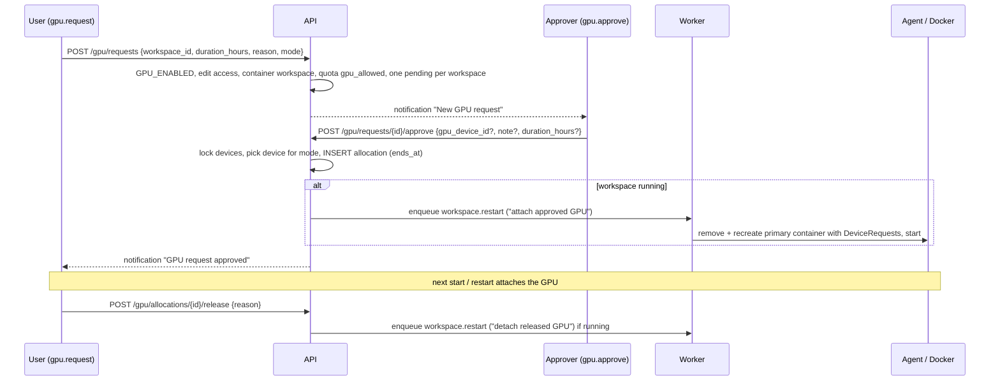

# GPU management

Jenderal Cloud OS manages NVIDIA GPUs through one module (`internal/modules/gpu`) and the agent's
`gpu.inventory` operation (`apps/agent/internal/gpu`). Users request access for a container
workspace, approvers allocate a specific GPU for a limited time, and the allocation is
attached to the workspace's primary container. The platform never pretends to partition GPU
memory.

Related: [workspaces](workspace.md) · [API](api.md#gpu) · [operations](operations.md) ·
[installation](installation.md).

## 1. Policy summary

- **Exclusive by default.** One active exclusive allocation per GPU, enforced by the
  partial unique index `gpu_allocations_exclusive_key`.
- **Shared mode is opt-in** (setting `gpu.allow_shared`, default false) and only on devices
  whose policy is `shared`, up to `max_shared` concurrent allocations. Shared means processes
  of several workspaces run on the same GPU with CUDA's default time-slicing and compete for
  VRAM; **no VRAM partitioning or isolation is provided**.
- **MIG is not assumed.** The MIG mode reported by the driver is stored and displayed only;
  the platform allocates whole GPUs.
- Allocations are bound to one workspace and expire (`duration_hours`, at most
  `gpu.max_duration_hours`, default 72).
- Workspaces without GPUs work normally when no GPU or driver is present.
- GPU features are active only with `GPU_ENABLED=true`.

## 2. Detection

The agent runs `nvidia-smi` (path `NVIDIA_SMI_PATH`, default `nvidia-smi`) with fixed
arguments, a 15 s timeout and a minimal environment:

```bash
nvidia-smi --query-gpu=index,uuid,name,driver_version,memory.total,memory.used,utilization.gpu,temperature.gpu,power.draw,mig.mode.current \
           --format=csv,noheader,nounits
nvidia-smi --query-compute-apps=gpu_uuid,pid,process_name,used_memory --format=csv,noheader,nounits
nvidia-smi        # header parsed for "CUDA Version"
```

- Memory values (MiB) are converted to bytes.
- Fields reported as `[N/A]`, `Not Supported` or empty become `null` and are shown as
  "Unavailable" — never as 0 (`TestParseQuery`).
- Without `nvidia-smi` the inventory is `{"available": false, "error": "nvidia-smi not found
  (NVIDIA driver not installed)", "gpus": []}`; a failing `nvidia-smi` reports its error the
  same way.
- Processes are listed per GPU (PID, name, memory). Attribution of a process to an ITK
  container is not implemented (`container_id` stays empty).
- `agent.info` reports `capabilities.nvidia` (nvidia-smi found) and
  `capabilities.nvidia_runtime` (Docker has an `nvidia` runtime or `nvidia-container-cli`
  exists).

## 3. Inventory sync

When `GPU_ENABLED=true`, the worker's metrics task (every
`monitoring.sample_interval_seconds`) calls `gpu.inventory` and:

- upserts each GPU by UUID into `gpu_devices` (index, name, driver and CUDA version, memory,
  utilisation, temperature, MIG mode, `last_seen_at`); status becomes `available` unless an
  administrator disabled the device;
- marks devices not present in a successful inventory as `missing`;
- stores samples (`resource_usage_samples`, scope `gpu`: utilisation, memory, temperature)
  and evaluates GPU alerts.

`GET /api/v1/gpu/devices` lists devices with `active_allocations`, `gpu_enabled`,
`nvidia_driver`, `nvidia_container_runtime`, and (for approvers, GPU managers and monitoring
users) live processes. `PATCH /api/v1/gpu/devices/{id}` (`gpu.manage`) sets
`allocation_policy` (`exclusive`/`shared`/`disabled`), `max_shared` (1–16) or `disabled`.

## 4. Request, approval, allocation, release



| Step | Endpoint | Rules |
|---|---|---|
| Request | `POST /api/v1/gpu/requests` | `gpu.request`; `GPU_ENABLED` (else 503); edit access to the workspace (else 404/403); container workspaces only; owner's quota package must have `gpu_allowed` (422 `quota_exceeded`); `duration_hours` 1–`gpu.max_duration_hours`; `reason` 10–2000 chars; `mode` `exclusive` (default) or `shared` (only if `gpu.allow_shared`); optional preferred `gpu_device_id` must be `available`; one pending request per workspace (409). Approvers are notified. |
| Approve | `POST /api/v1/gpu/requests/{id}/approve` | `gpu.approve`; approving one's own request requires `gpu.manage`; request must be pending; workspace not deleting/deleted. The device is chosen (or the requested/preferred one validated) among `available` devices ordered by index: devices with policy `disabled` or an active exclusive allocation are skipped; `exclusive` needs zero active allocations; `shared` needs policy `shared` and fewer than `max_shared` active allocations. Otherwise 409 ("No GPU is currently available…"). `duration_hours` may only shorten the request. `ends_at = now + hours`. A running workspace is restarted to attach the GPU. |
| Reject | `POST /api/v1/gpu/requests/{id}/reject` | `gpu.approve`; `note` ≥ 3 chars; requester notified. |
| Cancel | `POST /api/v1/gpu/requests/{id}/cancel` | requester, pending only. |
| Release | `POST /api/v1/gpu/allocations/{id}/release` | the allocation's user, or `gpu.approve`/`gpu.manage` (others get 404); active only. A running workspace is restarted to detach the GPU. |
| History | `GET /api/v1/gpu/requests`, `GET /api/v1/gpu/allocations` | own items; all for approvers (allocations also for `monitoring.view_host`); `?status=active` for active allocations. |

All steps are audited (`gpu.request`, `gpu.approve`, `gpu.reject`, `gpu.request_cancel`,
`gpu.release`, `gpu.device_update`) and generate notifications. The flow is verified by
`TestGPURequestApprovalFlow` (quota without GPU rejected, short reason rejected, foreign
workspace 404, self-approval 403, second exclusive approval 409, release by other user 404).

## 5. Container integration

- When the **primary container** of a workspace starts (start or restart job), the worker
  computes the GPU UUIDs of the workspace's active, unexpired allocations on `available`
  devices. If they differ from the container's current `gpu_device_ids`, the container is
  removed and **recreated** (data stays on the volume) — Docker device assignments can only
  be set at creation.
- The agent passes them as `HostConfig.DeviceRequests`:
  `{"Driver": "nvidia", "DeviceIDs": [<GPU UUIDs>], "Capabilities": [["gpu","compute","utility"]]}`.
  This requires the NVIDIA Container Toolkit to be configured for Docker.
- Additional (non-primary) containers never receive GPUs.
- Templates declare `gpu_mode`: `required` (e.g. `ml-cuda`) needs a quota package with
  `gpu_allowed` at workspace creation; `optional` (e.g. `jupyterlab`) and `none` do not.
  A `required` workspace can still start before an allocation is approved — CUDA then finds
  no device until the allocation is attached.

## 6. Expiry and stale allocations

Every 5 minutes (when `GPU_ENABLED`) the worker's `gpu_reconcile` task:

- expires allocations whose `ends_at` has passed (status `expired`, reason "expired:
  allocation time ended");
- releases allocations of workspaces that have not been running for longer than
  `gpu.release_after_stopped_minutes` (default 60; statuses stopped, suspended, failed,
  deleted, ready), reason "workspace not running; allocation released automatically";
- restarts running workspaces whose allocation ended so the GPU is detached, and notifies the
  user.

Expired allocations are excluded from container attachment immediately, even before the
reconcile run. Deleting a workspace releases its allocations and cancels pending requests.

## 7. Monitoring

- `GET /api/v1/monitoring/gpu` — live inventory (processes only for `monitoring.view_host`).
- `GET /api/v1/monitoring/history?scope=gpu&ref=<GPU UUID>&range=24h` — utilisation, memory,
  temperature history.
- Alerts: `gpu_temperature` (temperature ≥ `alerts.gpu_temp_c`, default 85 °C, critical) and
  `gpu_overutilized` (10-minute average utilisation ≥ `alerts.gpu_util_pct`, default 98 %,
  warning).

## 8. Setting up NVIDIA on Ubuntu 24.04

1. **Driver** (before installing Jenderal Cloud OS):
   ```bash
   sudo ubuntu-drivers list                 # recommended driver packages
   sudo ubuntu-drivers install              # or: sudo apt install nvidia-driver-<version>-server
   sudo reboot
   nvidia-smi                               # must list the GPUs and the CUDA version
   ```
2. **NVIDIA Container Toolkit** — the installer does this with `--with-gpu` (or automatically
   when `nvidia-smi` works). Manually, following NVIDIA's documentation:
   ```bash
   curl -fsSL https://nvidia.github.io/libnvidia-container/gpgkey | sudo gpg --dearmor -o /usr/share/keyrings/nvidia-container-toolkit-keyring.gpg
   curl -fsSL https://nvidia.github.io/libnvidia-container/stable/deb/nvidia-container-toolkit.list \
     | sed 's#deb https://#deb [signed-by=/usr/share/keyrings/nvidia-container-toolkit-keyring.gpg] https://#g' \
     | sudo tee /etc/apt/sources.list.d/nvidia-container-toolkit.list
   sudo apt-get update && sudo apt-get install -y nvidia-container-toolkit
   sudo nvidia-ctk runtime configure --runtime=docker
   sudo systemctl restart docker
   sudo docker run --rm --gpus all ubuntu:24.04 nvidia-smi    # sanity check
   ```
3. **Enable in Jenderal Cloud OS**: set `GPU_ENABLED=true` in `/etc/itk-cloud/itk-cloud.env`, then
   `sudo systemctl restart itk-cloud-api itk-cloud-worker`.
4. **Build the CUDA image**: `sudo installer/build-workspace-images.sh ml-cuda`
   (base `nvidia/cuda:12.9.2-cudnn-runtime-ubuntu24.04`; the host driver must support CUDA 12.9 —
   check the "CUDA Version" in `nvidia-smi`).
5. **Grant access**: assign a quota package with `gpu_allowed` (seeded: `research`) to
   eligible users; `gpu.request` is in the student/lecturer/assistant roles, `gpu.approve`
   in admin, `gpu.manage` only in super_admin.
6. **Verify**: *Administration → Agent status* shows `nvidia` and `nvidia_runtime`; *GPU*
   lists the devices; approve a test request, start the workspace and run `nvidia-smi` in its
   terminal (only the allocated GPU is visible).

## 9. Troubleshooting

| Symptom | Likely cause | Action |
|---|---|---|
| GPU page: "GPU support is not enabled on this server" / request 503 | `GPU_ENABLED=false` | Set it to true and restart API and worker. |
| Inventory "nvidia-smi not found (NVIDIA driver not installed)" | No driver or wrong `NVIDIA_SMI_PATH` | Install the driver, reboot; check `which nvidia-smi` for root. |
| `nvidia-smi failed: …` | Driver/kernel module mismatch after a kernel update | `sudo dkms status`, reinstall the driver or reboot into the matching kernel. |
| Devices listed but `missing` | GPU not reported in the last successful inventory (removed, fallen off the bus) | Check `nvidia-smi -L`, `dmesg \| grep -i nvrm`. |
| Approve returns 409 "No GPU is currently available…" | All suitable GPUs exclusively allocated, disabled, or policy mismatch for shared | Release/expire allocations, adjust device policy, or ask the user to wait. |
| Workspace start fails after approval with a container runtime error mentioning `nvidia` | Container Toolkit not configured for Docker | `nvidia-ctk runtime configure --runtime=docker && systemctl restart docker`; check `docker info \| grep -i runtime`. |
| `nvidia-smi` inside the workspace: "command not found" | Image without NVIDIA utilities and toolkit not injecting them | Use the `ml-cuda` template; capabilities include `utility`. |
| CUDA reports no device in an `ml-cuda` workspace | No active allocation, or the workspace was not restarted after approval | Check *GPU → Allocations*; restart the workspace. |
| CUDA "driver version is insufficient" | Host driver older than the image's CUDA 12.9 | Upgrade the host driver or build an image with an older CUDA base. |
| Allocation released unexpectedly | Expired (`ends_at`) or workspace not running for `gpu.release_after_stopped_minutes` | Request again; tune the setting. |
| `gpu_temperature` alerts | Cooling/airflow, sustained load | Check fans and room temperature; consider lowering the power limit with `nvidia-smi -pl`. |
