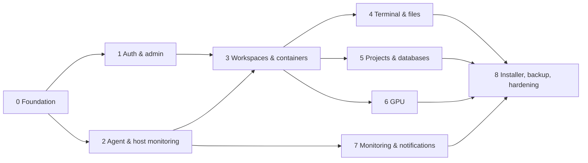

# ITK Cloud implementation plan and status

This plan breaks the specification (`ITK-CLOUD-SPEC.md` §23) into phases with tasks,
dependencies and acceptance criteria, and records the **actual, verified status** as of
2026-11-02 (release 0.1.3).

Legend: `[x]` implemented and verified (evidence named) · `[~]` implemented, verification needs
the lab's real hardware · `[ ]` not done.

## How it was verified

| Level | What ran | Result |
|---|---|---|
| Go unit tests (`-race`) | crypto, config, db/migrations, job queue, Redis limiter, agent protocol, agent server, file confinement, GPU parsing, backups | pass |
| Integration (`tests/integration`, real API + agent process + PostgreSQL 17 + Redis + Docker 29.9) | 11 tests: auth/MFA/RBAC, rate limit, all list endpoints per role, unique project slugs, project databases + backup/restore, encrypted platform backups, GPU approval, agent offline, JupyterLab app proxy, full container workspace lifecycle, quotas | pass |
| Security (`tests/security`) | IDOR on 27 endpoints, session fixation, secret leakage, injection, anonymous WebSocket, headers, body limits | pass |
| Web (`apps/web`) | eslint, prettier, svelte-check (0 errors/warnings, 35 pages), vitest | pass |
| Browser E2E (Playwright, `tests/e2e`) | admin MFA enrolment + crawl of 28 pages without errors; MVP journey (create users → password change → project → workspace wizard → start → xterm terminal → file upload/download → isolation → stop → audit) | pass on the dev stack **and** on the staging install |
| Staging install | `installer/install.sh` on Ubuntu 24.04.5 (arm64, systemd as PID 1 in a privileged container), then `upgrade.sh` 0.1.0 → 0.1.1 → 0.1.2 → 0.1.3 | pass (see below) |
| Load test (`tests/load`) | 50 concurrent clients, 30 s, polled read endpoints | 4 447 req/s, 0 errors, p95 27 ms, p99 75 ms |
| Contract | Redocly lint of `packages/api-contracts/openapi.yaml` (124 routes) | valid, 6 documented warnings |
| Scripts | shellcheck `-S warning` on all installer scripts | clean |

Staging findings fixed during verification: installer `VERSION` clobbered by
`/etc/os-release`; `pipefail` failures in helper pipelines; agent systemd hardening that put
the agent in a private mount namespace (Docker saw empty workspace directories); OOM kills on
large writes to loopback volumes (now attached with direct I/O); corrupt config backups when
a file is unreadable; stale drop-in not removed on upgrade; `itkctl` wrapper that loads the
configuration. On staging, loopback quotas were verified (a 6 GB write stops at the 5 GiB
quota, no OOM), workspace deletion detaches loop devices and removes data, and services
survive a restart. The staging host is a container on Docker Desktop; a final check on the
physical lab server (GPU, AppArmor, real network) is still required (§30 items below).

## Dependencies between phases

## Phase 0 — Discovery and foundation

Acceptance: the repository can be cloned, dependencies installed and every application built. **Met.**

- [x] Versions verified against the official registries and pinned (`go.sum`, `pnpm-lock.yaml`):
      Go 1.27.3 toolchain (`go 1.26.0` in `go.mod`), pgx 5.12.0, go-redis 9.23.0, goose 3.29.0,
      coder/websocket 1.8.15, creack/pty 1.1.24, gopsutil 4.26.10, age 1.3.2, x/crypto 0.58.0;
      SvelteKit 3.1.1, Svelte 5.57.3, Vite 8.3.5, Tailwind 4.3.3, TypeScript 6.0.3, xterm 6.0.0;
      Node.js 24.22.2 LTS on the server (checksum-verified download).
- [x] ADRs [0001–0010](adr/README.md); monorepo layout; `Makefile`; CI workflow
      (`.github/workflows/ci.yml`, not yet run because the repository has no remote/commits).
- [x] `.env.example`, `.gitignore`, development docs, this plan.
- [x] Everything builds: `make build`, `make release` (linux amd64 + arm64 tarballs).

## Phase 1 — Authentication and basic administration — **met**

- [x] Schema + reference data — `TestMigrateUpIsIdempotent` (migrations serialised by an advisory lock).
- [x] Sessions, CSRF, cookie flags, rotation — `TestAuthMFAAndRBAC`, `TestSessionFixationAndCookieFlags`.
- [x] Argon2id, password policy, forced change — unit tests + E2E journey.
- [x] TOTP MFA (mandatory for admin roles), recovery codes, replay protection — unit tests + E2E (UI enrolment).
- [x] Lockout and rate limits — `TestLoginRateLimit`, `TestAuthMFAAndRBAC`.
- [x] Password reset (SMTP or admin link) — `TestAuthMFAAndRBAC`.
- [x] Users, RBAC with ranks, custom roles, audit log, settings — integration + security tests.
- [x] Console: login, MFA, reset, users, roles, quotas, audit, settings — E2E crawl and journey.

## Phase 2 — Host agent and monitoring — **met**

- [x] Allow-listed, versioned, HMAC-signed protocol over a 0660 Unix socket — protocol and agent tests.
- [x] Host inventory/metrics, Docker status, honest offline reporting — `TestAgentOfflineIsReportedHonestly`, staging.
- [x] `itk-cloud-agent.service` — verified on staging (host mount namespace, socket `root:itk-cloud 0660`).

## Phase 3 — Workspaces and containers — **met**

- [x] 11 templates/images, allowlist, wizard — integration + E2E.
- [x] Lifecycle state machine with idempotent jobs — `TestContainerWorkspaceLifecycle`, job tests, E2E.
- [x] Hardened containers (uid 1000, cap drop ALL, no-new-privileges, CPU/memory/swap/PIDs, per-workspace network, loopback-only ports, no Docker socket) — `docker inspect` assertions; on staging `CapEff=0`, `NoNewPrivs=1`.
- [x] Storage quotas enforced by loopback ext4 volumes (direct I/O) — staging.
- [x] Quotas, host-capacity check, idle stop/max duration, members, emergency access — tests (idle stop/capacity: no automated test yet).
- [x] JupyterLab via the isolated app-proxy origin with per-container token — `TestJupyterLabThroughAppProxy`.

## Phase 4 — Terminal and file manager — **met**

- [x] xterm.js terminal with WebSocket relay, re-authorisation on reconnect, Origin check, idle/max duration — integration + E2E (dev and staging).
- [x] File manager (list, upload, download, mkdir, rename, delete, editor with conflict detection) confined by `os.Root` — fsops tests, integration, E2E.
- [~] Native (host) workspace terminals via `systemd-run` scopes — implemented, disabled by default, not yet exercised on staging.

## Phase 5 — Projects and databases — **met**

- [x] Projects, membership roles, activity, unique slugs — integration + E2E.
- [x] Project databases (database + role each, CONNECT revoked from PUBLIC, password shown once, reset, typed delete) — `TestProjectDatabaseLifecycle`.
- [x] Project quota packages — implemented (no dedicated test).

## Phase 6 — GPU management — **met in software; hardware pending**

- [x] Inventory parsing, sync, requests, approval policy (exclusive/shared), release, expiry/stale release, process→container attribution — unit + `TestGPURequestApprovalFlow`.
- [~] Device attachment (`DeviceRequests` + NVIDIA Container Toolkit) — needs the lab GPU server.

## Phase 7 — Monitoring and notifications — **met**

- [x] Host/workspace/GPU metrics, history, services, alert rules with notifications, failed-job retry, announcements — integration + E2E crawl.
- [x] Optional Prometheus/node_exporter/Grafana configuration (`deployments/monitoring`, `--with-monitoring`) — written; not exercised on staging.

## Phase 8 — Installer, backup and hardening — **met on staging**

- [x] `install.sh`, `upgrade.sh` (pre-upgrade encrypted backup, ordered restart, health check, automatic binary rollback), `backup.sh`, `uninstall.sh`, `build-workspace-images.sh` — staging + shellcheck.
- [x] systemd units, Caddy (internal TLS, separate app-proxy origin), Docker daemon and Redis configuration, UFW — staging.
- [x] Encrypted backups of all kinds, schedule, retention, copy location, web restore/verify — integration tests; pre-upgrade backups on staging.
- [x] Security regression tests and basic load test — pass.
- [x] Operations, backup/restore and installation documentation.
- [ ] Restore drill of `itkctl restore platform-db` and workspace files on the real server.

## MVP status (spec §24) — all flows done and verified in the browser

| # | Flow | Evidence |
|---|---|---|
| 1 | Administrator login (with MFA) | E2E `01-admin-smoke`, `TestAuthMFAAndRBAC` |
| 2 | Administrator creates and manages users | E2E journey, `TestAuthMFAAndRBAC` |
| 3 | User login (forced password change) | E2E journey |
| 4 | User creates a project | E2E journey |
| 5 | User creates a container workspace from a template | E2E journey, `TestContainerWorkspaceLifecycle` |
| 6 | CPU, RAM and storage limits applied | `docker inspect` assertions; loopback quota on staging |
| 7 | Terminal in the browser | E2E journey (xterm.js over WebSocket) |
| 8 | File management in the workspace | E2E journey |
| 9 | Administrator monitors host and containers | E2E crawl of monitoring pages, integration |
| 10 | Audit log | E2E journey (admin audit page), integration |

## Production release checklist (spec §30)

- [x] All MVP acceptance criteria met (dev + staging).
- [x] No sensitive endpoint without authorization (`TestListEndpointsForAllRoles`, `TestIDOR`).
- [x] Ownership checks tested.
- [x] Docker socket not exposed to the web application.
- [x] Host agent only runs allow-listed operations.
- [x] Resource limits actually applied (CPU/memory/PIDs/storage).
- [x] Workspaces and files isolated.
- [x] Login rate limit and session security active.
- [x] Internal HTTPS active (staging).
- [ ] Firewall opens only required ports — UFW rules applied on staging; external port scan on the real server pending.
- [x] Secrets not stored in the repository (generated at install, `.gitignore`; gitleaks in CI once pushed).
- [ ] Backups scheduled and restore tested — automated tests pass; full DR drill on the real server pending.
- [ ] Monitoring of services and host active — verified on staging; enable on the real server.
- [x] Installer and upgrade tested on a staging server (Ubuntu 24.04 container); repeat on the physical server.
- [x] Security regression tests and basic load test passed.
- [x] Installation and recovery documentation available.
- [ ] Administrators trained on emergency stop and recovery.

## Remaining follow-ups

1. Run the installer on the physical lab server (amd64, AppArmor, NVIDIA GPU) and repeat the
   E2E suite there (`E2E_BASE_URL=https://<domain> make test-e2e`); fill in the hardware
   inventory (spec §29) and tune quota packages.
2. GPU attachment test with an approved allocation on real hardware.
3. Automated tests for idle stop, host-capacity refusal, native workspaces and the CLI restore.
4. Optional hardening: egress filtering for workspace networks, Alertmanager, off-host audit
   export, workspace volume resize, gVisor/Kata for high-risk workloads.
