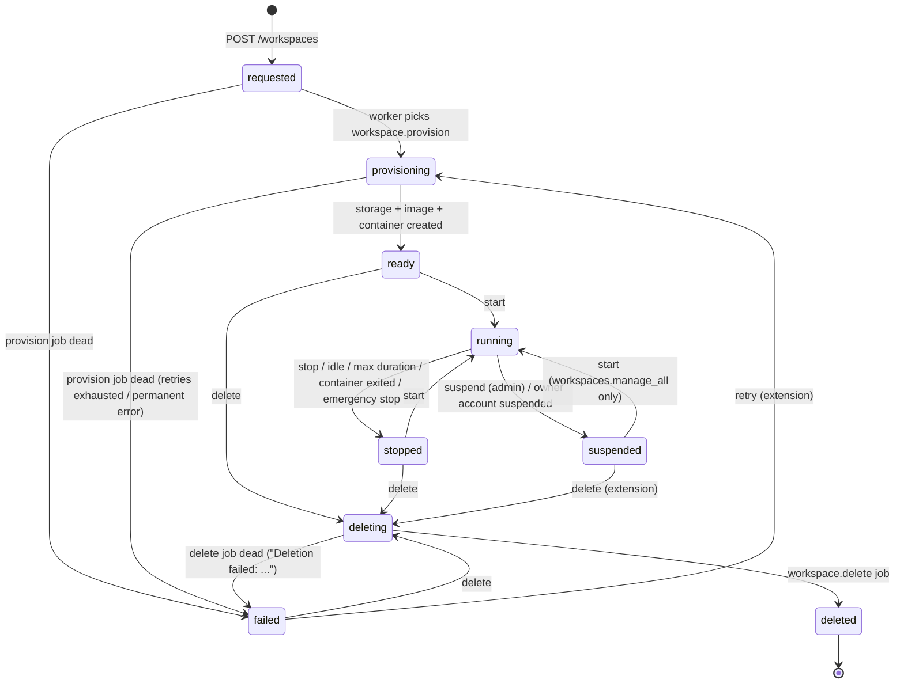

# Workspaces

A workspace is a user's computing environment: an owner, a template, resource limits, a
persistent storage volume, optionally a project, members, and one or more containers (or a
Linux account for native workspaces). Implementation: `internal/modules/workspaces`,
`internal/modules/containers`, `internal/modules/resources`, agent operations in
[agent-protocol.md](agent-protocol.md).

Related: [API](api.md) · [architecture](architecture.md) · [GPU](gpu.md) · [security](security.md).

## 1. Workspace types

| | Container workspace (default) | Linux-native workspace |
|---|---|---|
| `type` | `container` | `native` |
| Availability | always | only with `WORKSPACE_NATIVE_ENABLED=true` (API **and** agent) and the permission `workspaces.native` (only `super_admin` by default) |
| Isolation | Docker container per the hardening profile, per-workspace network | Dedicated unprivileged Linux account; shells in a transient systemd scope with cgroup limits; shares the host network and filesystem namespace |
| Storage | Volume mounted at `/home/jenderal` | Same volume used as the account's home directory |
| Terminal | `docker exec` as uid 1000 | `systemd-run --scope` as the dedicated user |
| Additional containers, app proxy, GPU | yes | no |
| Recommended for | everyone | trusted users who need host tooling, after explicit approval |

`WORKSPACE_DEFAULT_DRIVER` (`docker` → container) decides the type when the request omits it.

## 2. Lifecycle

States: `requested`, `provisioning`, `ready`, `running`, `stopped`, `suspended`, `failed`,
`deleting`, `deleted`. The allowed transitions (`transitions` in
`internal/modules/workspaces/model.go`) implement the spec §10.2 diagram plus two documented
extensions: **`failed → provisioning`** (retry) and **`suspended → deleting`** (cleanup of
suspended accounts).



Every requested transition is validated in a transaction that locks the workspace row; an
action is refused with `409` while another lifecycle job for the workspace is queued or
running. `restart` is allowed only while `running` and keeps the state. Each action is
audited (`workspace.start`, `workspace.stop`, …) and the worker records completion
(`workspace.provisioned`, `workspace.started`, `workspace.stopped`, `workspace.deleted`).
Deleted workspaces stay in the database (`deleted_at`, status `deleted`) but are treated as
not found by the API.

### Jobs per transition

| Action (API) | Precondition | Job | What the job does (via the agent) |
|---|---|---|---|
| create (`POST /workspaces`) | quotas (§4) | `workspace.provision` (key `workspace.provision:<id>`, 5 attempts) | status `provisioning`; `native.user_ensure` (native); `workspace.provision` (volume); container: `image.ensure` (pull if missing; a missing local image is a permanent failure) and `container.create` for every container without runtime ID → `ready`, owner notified |
| `start` | `ready`/`stopped` (`suspended` with manage_all); run quota + host capacity (§5) | `workspace.start` | containers: (re)create the primary container if GPU allocations changed or it vanished, `container.start`, record loopback host ports; native: ensure storage → `running`, `started_at`, `last_activity_at` |
| `stop` | `running` | `workspace.stop` | `container.stop` (15 s grace) for each container → `stopped`; closes terminal sessions |
| `suspend` | `running`, manage access + `workspaces.manage_all`, reason | `workspace.stop` with `suspend=true` | as stop → `suspended`; owner notified |
| `restart` | `running` | `workspace.restart` | primary container stop + start (applies GPU changes); other running containers `container.restart` |
| `retry` | `failed`, manage access | `workspace.provision` (new key per retry) | as create |
| `delete` | `ready`/`stopped`/`suspended`/`failed`; owner + `workspaces.delete`, or manage + `workspaces.manage_all` | status set to `deleting` synchronously; `workspace.delete` (key `workspace.delete:<id>`) | `workspace.destroy` (containers, network, volume, native user); marks containers removed, releases GPU allocations, cancels pending GPU requests, closes terminals → `deleted`, owner notified |
| suspend owner account | `POST /users/{id}/suspend` | `workspace.stop` (`suspend=true`) for each running workspace | as suspend |

When a job exhausts its retries (`dead`): provisioning → `failed` with the reason (owner
notified, *Retry* available); deletion → `failed` ("Deletion failed: …"); start/stop/restart
→ `status_reason` "Last operation failed: …" (owner notified). If the agent is offline,
provisioning stays in `provisioning` with a pending job that keeps retrying (verified by
`TestAgentOfflineIsReportedHonestly`).

The metrics task reconciles containers that stopped outside the platform (crash, OOM,
manual `docker stop`): the container becomes `stopped` with the exit reason, and the workspace
`stopped` when no container is running.

## 3. Containers in a workspace

A container workspace has a **primary container** (`main`, created with the workspace) and
can have additional containers (`POST /containers`, requires `containers.create` and edit
access) from any active template, sharing the workspace volume (`/home/jenderal`) and network.
Additional containers count toward `max_containers`; the primary container is removed only
with the workspace. Container states: `created`, `starting`, `running`, `stopping`,
`stopped`, `failed`, `removing`, `removed`. Stopping the last running container marks the
workspace `stopped`. Each container runs with its own CPU/memory limits and `pids_limit`
512. Changing a workspace's CPU/memory (`PATCH /workspaces/{id}`, stopped workspaces only)
removes the primary container so it is recreated with the new limits on the next start —
data on the volume is preserved.

## 4. Quotas

Each user has an **effective quota package**: the package assigned to the user
(`users.quota_id`) or else the package named by the setting `quota.default_package`
(default `basic`). Projects can optionally have their own package. Quotas are checked against
the **owner** of the workspace (not the administrator acting on their behalf).

| Limit (package field) | Enforced when | Semantics as implemented |
|---|---|---|
| `cpu_millis`, `memory_bytes` | create, settings change | Each workspace's/container's limit must be between the template minimum and the package value. |
| `cpu_millis`, `memory_bytes` | start (workspace or container) | **Running** aggregate: sum of CPU/memory of the owner's running/starting containers plus running native workspaces, plus the new demand, must not exceed the package. Stopped workspaces do not count. |
| `storage_bytes` | create | **Allocated** aggregate: sum of `storage_bytes` of the owner's live workspaces (not `deleting`/`deleted`) plus the new allocation must not exceed the package. |
| `max_workspaces` | create | Live workspaces of the owner `<` min(`max_workspaces`, setting `workspaces.max_per_user_hard_limit` (20)). |
| `max_containers` | create workspace, add container | Live containers in the owner's live workspaces `<` limit. |
| `max_databases` | create database | Live databases created by the user. |
| `max_terminal_sessions` | open terminal | Open (pending/active, unexpired) sessions of the user. |
| `gpu_allowed` | create workspace from a `gpu_mode: required` template; GPU request | Must be true. |
| `idle_timeout_min` | create | Default idle timeout of new workspaces (user may override 5–10080 min, or disable later). |
| `max_workspace_duration_min` | create | Copied to the workspace (`max_duration_min`); not user-editable. |

Project packages (when assigned) add: workspaces count and allocated storage at creation,
running CPU/memory at start, database count. Errors return `422 quota_exceeded` with a
readable message ("Storage quota exceeded: 4.0 GiB allocated of 5.0 GiB; requested 2.0 GiB.").
Storage is additionally **enforced by the filesystem** with the `loopback` storage driver:
writes beyond the volume size fail (`507 quota_exceeded`). Owners are notified when a
workspace uses ≥ 90 % of its volume (checked every 5 min, at most once a day).

Seeded example packages (spec §12 — tune them to the hardware before production):

| Key | CPU | RAM | Storage | Workspaces | Containers | Databases | Terminals | GPU | Idle timeout |
|---|---:|---:|---:|---:|---:|---:|---:|:---:|---:|
| `basic` | 1 core | 1 GiB | 5 GiB | 2 | 3 | 1 | 3 | no | 120 min |
| `standard` | 2 cores | 4 GiB | 20 GiB | 3 | 6 | 2 | 5 | no | 240 min |
| `research` | 4 cores | 8 GiB | 50 GiB | 5 | 10 | 5 | 10 | yes | 480 min |

`GET /api/v1/me/usage` returns the effective package and current usage (`running_cpu_millis`,
`running_memory_bytes`, `allocated_storage_bytes`, `used_storage_bytes`, counts).

## 5. Scheduler (host capacity)

Before a workspace or container start is enqueued, `CheckHostCapacity`
(`internal/modules/resources`) uses the latest host sample (≤ 10 minutes old) and the agent's
CPU thread count:

- **Memory**: running memory of all workloads + demand must be ≤ **90 %** of host RAM.
- **CPU**: running CPU of all workloads + demand must be ≤ threads × 1000 ×
  `scheduler.cpu_overcommit_pct` / 100 (default **200 %**, range 100–1000).

Otherwise the start fails with `503 insufficient_capacity`. If no recent host sample exists
(e.g. agent or worker down) the capacity check is skipped and only quotas apply. Disk is not
checked at start; loopback volumes are sparse files and disk usage is covered by the
`disk_full` alert.

## 6. Members and access levels

Access levels (`internal/modules/workspaces/access.go`):

| Level | Allows |
|---|---|
| `view` | Metadata, status, containers, members, jobs |
| `operate` | Start/stop/restart, container start/stop/restart, logs, workload metrics |
| `edit` | Private data: files, terminal, app proxy, add/remove containers, GPU requests |
| `manage` | Settings (`PATCH`), members, retry, suspend (with manage_all), delete (with manage_all) |

How a principal obtains them:

| Principal | view | operate | edit | manage |
|---|:---:|:---:|:---:|:---:|
| Owner | ✓ | ✓ | ✓ | ✓ |
| Workspace member `editor` | ✓ | ✓ | ✓ | |
| Workspace member `viewer` | ✓ | | | |
| Project member (any role) | ✓ | | | |
| Project `owner`/`maintainer` | ✓ | ✓ | | |
| `workspaces.view_all` | ✓ | | | |
| `workspaces.manage_all` | ✓ | ✓ | | ✓ |
| `workspaces.access_all` (emergency) | ✓ | | ✓ (with `X-Access-Reason`, audited) | |

Without `view` the API answers **404**; with `view` but without the required level **403**.
Emergency access requires the `X-Access-Reason` header (≥ 10 characters) on every data
request and is audited as `workspace.emergency_access`; terminal sessions opened this way
store the reason. The app proxy never accepts emergency access. Members are managed with
`POST /workspaces/{id}/members` (`viewer`/`editor`) and `DELETE …/members/{userId}` (closes the
member's terminals). The `access` field of workspace responses shows the caller's effective
level (`owner`, `editor`, `operator`, `viewer`).

## 7. Idle stop and maximum duration

Every minute (when the setting `workspaces.idle_stop_enabled` is true) the worker enqueues a
stop for running workspaces where:

- `idle_timeout_min` is set, the last activity (`last_activity_at`, else `started_at`) is
  older than the timeout, **and** no active terminal session had activity within the timeout;
  or
- `max_duration_min` is set and `started_at` is older than it.

Workspaces with a pending job are skipped. Activity is recorded when the workspace starts,
on terminal connect and every 15 s while a terminal is connected, on file operations and on
app-proxy requests (at most every 30 s). The owner is notified ("Automatically stopped: idle
timeout reached" / "maximum duration reached"). Setting `idle_timeout_min` to 0 disables idle
stop for a workspace.

## 8. Templates and images

Templates define the image, runtime versions, minimum and recommended CPU/memory, default
storage, ports, GPU mode (`none`/`optional`/`required`), environment, command and security
profile (uid/gid 1000, no-new-privileges, optional read-only root filesystem, no added
capabilities). Templates can only reference images on the allowlist
(`container_images.is_allowed`); templates and images are managed with `templates.manage` /
`images.manage`. Template changes do not alter existing workspaces' limits.

The 11 built-in templates (`migrations/00002_seed_reference_data.sql`):

| Template key | Image (`itk-cloud/<name>:1.0`) | Base image | Runtime | Min CPU / RAM | Rec. CPU / RAM | Storage | Ports | GPU |
|---|---|---|---|---|---|---|---|---|
| `ubuntu-dev` | `ubuntu-dev` | `ubuntu:24.04` | Ubuntu 24.04, build-essential, git | 0.5 / 512 MiB | 1 / 1 GiB | 5 GiB | — | none |
| `go-dev` | `go-dev` | `golang:1.27-bookworm` | Go 1.27 (`GOPATH=/home/jenderal/go`) | 0.5 / 512 MiB | 1 / 2 GiB | 5 GiB | 8080 | none |
| `php-laravel` | `php-laravel` | `php:8.4-cli-bookworm` | PHP 8.4, Composer 2 | 0.5 / 512 MiB | 1 / 1 GiB | 5 GiB | 8000 | none |
| `nodejs-dev` | `node-dev` | `node:24-bookworm` | Node.js 24, npm, pnpm | 0.5 / 512 MiB | 1 / 2 GiB | 5 GiB | 3000, 5173 | none |
| `python-dev` | `python-dev` | `python:3.13-bookworm` | Python 3.13 | 0.5 / 512 MiB | 1 / 1 GiB | 5 GiB | 8000 | none |
| `python-datascience` | `python-datascience` | `python:3.13-bookworm` | Python 3.13 + numpy, pandas, scikit-learn, matplotlib | 1 / 1 GiB | 2 / 4 GiB | 10 GiB | — | none |
| `jupyterlab` | `jupyterlab` | `python:3.13-bookworm` | JupyterLab 4, Python 3.13 | 1 / 1 GiB | 2 / 4 GiB | 10 GiB | 8888 (proxy-aware) | optional |
| `ml-cuda` | `ml-cuda` | `nvidia/cuda:12.9.2-cudnn-runtime-ubuntu24.04` | CUDA 12.9, Python 3 (PyTorch installed by the user) | 2 / 4 GiB | 4 / 8 GiB | 20 GiB | 8888 | required |
| `cpp-dev` | `cpp-dev` | `ubuntu:24.04` | GCC, Clang, CMake, GDB, Valgrind | 0.5 / 512 MiB | 1 / 1 GiB | 5 GiB | — | none |
| `java-dev` | `java-dev` | `eclipse-temurin:21-jdk-noble` | JDK 21, Maven, Gradle | 1 / 1 GiB | 2 / 2 GiB | 5 GiB | 8080 | none |
| `web-dev` | `web-dev` | `node:24-bookworm` | Node.js 24, PHP 8.4, Python 3 | 1 / 1 GiB | 2 / 2 GiB | 10 GiB | 3000, 5173, 8000 | none |

All images run as the unprivileged user `jenderal` (uid/gid 1000) with home `/home/jenderal`, contain no
SSH server and no sudo, and use the entrypoint `jenderal-entrypoint`, which seeds `.bashrc`/`.profile`
into an empty home. Containers receive `ITK_WORKSPACE_ID`, `ITK_CONTAINER_ID`,
`ITK_WORKSPACE_NAME`, `ITK_PROXY_BASE`, `ITK_APP_TOKEN` (per-container token derived from
`SESSION_SECRET`; the app proxy injects it as `Authorization: token …`) and (when configured)
`ITK_APP_ORIGIN`.

**Container command.** When a template's `command` is empty the agent runs `sleep infinity`
(through the image entrypoint) so the container stays up for terminals. The seeded JupyterLab
template sets `["/usr/local/bin/start-jupyter"]` (migration `00005`), so JupyterLab starts
automatically, listens on port 8888 under `ITK_PROXY_BASE` and requires `ITK_APP_TOKEN`; it is
opened from the workspace's *Containers* tab ("Open app") through the app-proxy origin.

**Building images.** Images are built on the server (they are not pulled from a registry):

```bash
sudo installer/build-workspace-images.sh                 # all images
sudo installer/build-workspace-images.sh jupyterlab      # one image
ITK_IMAGE_TAG=1.0 sudo installer/build-workspace-images.sh ubuntu-dev
```

The build context is `deployments/docker/workspace-images` (`common/` holds the entrypoint and
bashrc snippet). Tags must match the catalog references. After a rebuild, existing containers
keep the old image until they are recreated (e.g. after a CPU/memory change or GPU
change); new workspaces use the new image. Use *Check / pull* in the image catalog to refresh
`pulled_at`/size.

**Adding a custom image/template**: build or pull the image, add it with `POST /images`
(lowercase reference, e.g. `jenderal/rstudio:1.0`), then create a template with
`POST /templates` (min/rec CPU ≥ 100 millicores, memory ≥ 64 MiB, storage ≥ 256 MiB, ports
1024–65535). The image must run as a non-root user with uid 1000 and should keep `/home/jenderal`
as home.

## 9. Linux-native workspaces

Disabled by default. Requirements:

- `WORKSPACE_NATIVE_ENABLED=true` in both `/etc/itk-cloud/itk-cloud.env` and
  `/etc/itk-cloud/agent.env` (installer: `--enable-native`);
- Linux with `useradd`, `userdel` and `systemd-run` (agent capability `native_workspaces`);
- the group `AGENT_NATIVE_GROUP` (default `itk-workspace`) must exist;
- the permission `workspaces.native` (only `super_admin` by default — grant it through a
  custom role to approved users).

Behaviour: provisioning creates the account `itk-<12 hex chars of the workspace ID>` with
home = the workspace volume, shell `/bin/bash`, primary group `itk-workspace`, no password
and no sudo. Terminals run `bash -l` as that user inside
`systemd-run --scope --slice=itk-native.slice` with `CPUQuota` (from `cpu_millis`),
`MemoryMax` (from `memory_bytes`), `MemorySwapMax=0` and `TasksMax` (pids limit, at least 64).
"Running" means the volume is mounted and terminals may be opened; stopping closes terminal
sessions. Deletion removes the account and the volume.

Caveats: native users share the host kernel, network namespace and the rest of the
filesystem (subject to Unix permissions); they can reach services on host loopback, including
other users' JupyterLab ports ([security.md §6](security.md#6-known-limitations-and-residual-risks));
background processes are confined by the scope's limits but are not part of the container
model; emergency stop does not kill native shells. Use only for trusted users.

## 10. App proxy

Web apps listening on template ports inside a running container are reachable for the
owner and editors at:

```
<APP_PROXY_ORIGIN>/api/v1/workspaces/<workspace id>/proxy/<port>/
```

- Only template ports are published (on `127.0.0.1`, random host port); the proxy looks up
  the loopback port of a running container with that template port.
- Ports flagged `proxy: true` (JupyterLab) receive the full path; apps must then serve under
  the base path `ITK_PROXY_BASE + <port>/` (JupyterLab is started with
  `--ServerApp.base_url` accordingly). Other ports get the prefix stripped and see `/`.
- Dev servers must listen on `0.0.0.0` inside the container (e.g. `vite --host 0.0.0.0`,
  `php artisan serve --host 0.0.0.0`).
- The proxy is available only when `APP_PROXY_ORIGIN` is configured; it refuses requests on
  the console origin. Security rationale: [architecture.md §9.3](architecture.md#93-app-proxy-on-a-separate-origin).

## 11. Storage

Each workspace has one volume (`WORKSPACE_ROOT/<id>/data`, mounted at `/home/jenderal`) sized
`storage_bytes` at creation. With the `loopback` driver the size is a hard limit; with the
`directory` driver usage is only measured. The storage size cannot be changed after creation
in the current version. Everything outside `/home/jenderal` in a container (apt installs,
`/var/tmp`) lives in the container's writable layer and is lost when the container is
recreated; `/tmp` is a tmpfs. See [architecture.md §10](architecture.md#10-workspace-storage-drivers).
